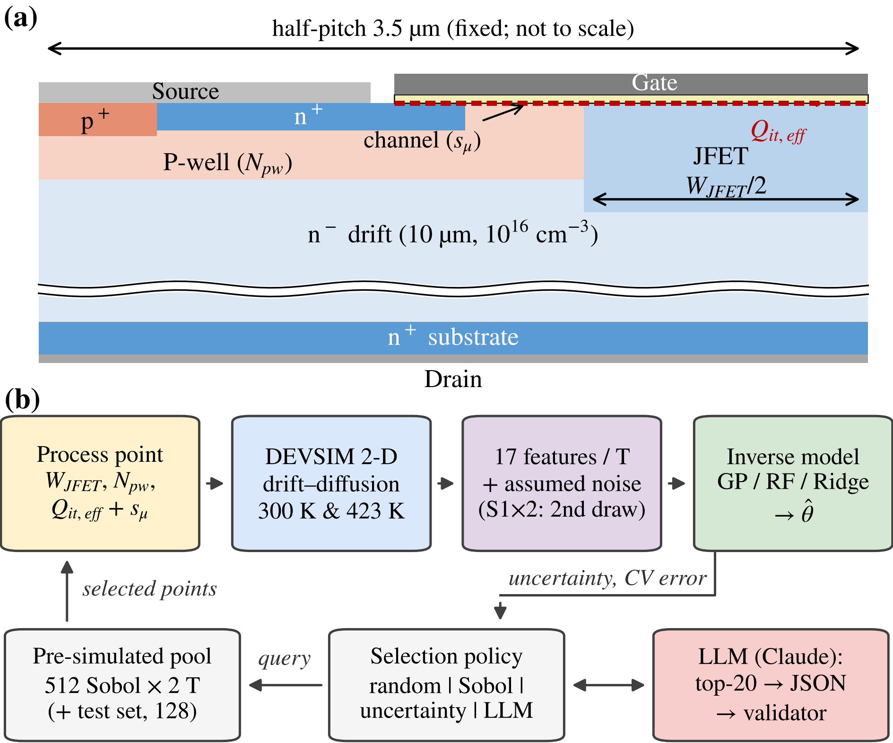

# sic-mosfet-devsim

Code, settings and raw data for **Improving JFET-Width Inverse Estimation of 4H-SiC MOSFETs with 423K Features and Evaluating LLM-Assisted Sampling** (Minseok Lee, Kwangwoon University; IEIE Fall Conference 2026, poster session).

[](https://github.com/mseokq23/sic-mosfet-devsim/actions/workflows/ci.yml?query=branch%3Amain)
[](LICENSE)
[](environment.txt)
[](environment.txt)

A 4H-SiC planar MOSFET is simulated with DEVSIM at 300 K and 423 K. Three process parameters are estimated back from the I–V features, and sampling policies, one of them LLM-assisted, are compared for choosing which devices to simulate.

**Results page:** [mseokq23.github.io/sic-mosfet-devsim](https://mseokq23.github.io/sic-mosfet-devsim/) (poster figures, interactive)

<p align="center"></p>

## Experiment

2-D half-cell of a 1.2 kV planar MOSFET: half-pitch 3.5 µm, 50 nm gate oxide, 10 µm drift at 1×10<sup>16</sup> cm<sup>−3</sup>.

| Parameter | Range | Role |
|---|---|---|
| JFET width W<sub>JFET</sub> | 0.8–1.2 × 2.4 µm | estimated |
| P-well doping N<sub>pw</sub> | 0.8–1.2 × 1×10<sup>17</sup> cm<sup>−3</sup> | estimated |
| Effective interface charge Q<sub>it,eff</sub> | −1.5 to −0.5 ×10<sup>12</sup> cm<sup>−2</sup> | estimated |
| Channel mobility scale s<sub>μ</sub> | 0.8–1.2 | nuisance |

| Step | What | Figures |
|---|---|---|
| 1. Devices | 512 Sobol points (training pool) and 128 random test devices | |
| 2. DEVSIM 2-D | Transfer and output curves at 300 K and 423 K (1,280 runs); 423 K repeated with four other physics assumptions (2,560 runs) | [design centre](docs/figures/iv_baseline.png) · [one parameter ±20 %](docs/figures/iv_one_at_a_time.png) · [test devices](docs/figures/iv_population.png) · [423 K physics](docs/figures/variants_423k.png) |
| 3. Features | 17 per temperature (V<sub>th</sub>, SS, g<sub>m,max</sub>, I<sub>on</sub>, R<sub>on,sp</sub>, I<sub>D</sub>, 11 log I<sub>D</sub> points) + measurement noise | [features vs. parameters](docs/figures/features_vs_parameters.png) |
| 4. GP inverse model | Features → parameters, scored on the test devices for each input set below | [errors](docs/figures/estimation_errors.png) · [physics mismatch](docs/figures/robustness_423k.png) |
| 5. Sampling loop | 60 random pool devices, then 6 rounds of 10 picks: random, Sobol, uncertainty, or LLM-assisted (Claude picks 10 of the 20 most uncertain). Random forest on S2, 10 seeds | [learning curves](docs/figures/selection_curves.png) |

Input sets (same devices, different measurements):

| S1 | S1×2 | S2 | S3 |
|---|---|---|---|
| 300 K ×1 | 300 K ×2, averaged | 300 K + 423 K | S2 + (423 K − 300 K) differences |

## Results

Error: MAE<sub>norm</sub> = |estimate − true| ÷ range, averaged over the three parameters (guessing the midpoint gives 0.25). Nominal, independent noise.

- **RQ1. Does 423 K add more than a repeated 300 K measurement?** Yes, but about two-thirds of its gain is noise averaging (S1 0.112, S1×2 0.086, S2 0.072). The 423 K-specific part is in W<sub>JFET</sub> (0.079 → 0.050, −36 %); it survives correlated noise but reverses under a wrong 423 K mobility model (S2 0.537 and 0.928).
- **RQ2. Does adaptive sampling save TCAD runs?** Slightly. Uncertainty sampling reached the random policy's 120-device error with about 12 % fewer runs (post hoc); no difference from Sobol order was detected.
- **RQ3. Does an LLM use the numbers it is shown?** Yes, even wrong ones. With shuffled numbers, 64 % of its picks were in the shown top 10 and 49 % in the true top 10 (random: 50 %). No difference from uncertainty sampling was detected in final error.

## Reproduce

A Codespace (**Code → Codespaces → Create codespace on main**) installs everything. Locally, with Python 3.12 on Linux:

```bash
git clone https://github.com/mseokq23/sic-mosfet-devsim.git && cd sic-mosfet-devsim
pip install -r requirements.txt && pip install -e .
export MKL_NUM_THREADS=1 OMP_NUM_THREADS=1

python scripts/check_paper_numbers.py   # 123 paper numbers vs. result files (seconds)
bash scripts/reproduce_l1.sh            # all analyses from the stored runs (~12 min)
python scripts/rerun_check.py           # re-simulate one stored device (~1 min)

# step 2 from scratch (all 3,840 runs: ~50 core-hours)
python -m sicsim.runner configs/design_pool.csv --out results/pool --jobs 4
```

The LLM policy reads `ANTHROPIC_API_KEY` (model `claude-sonnet-5-5`). Every call is logged in [`results/al_live/`](results/al_live/) and [`results/al_ablation/`](results/al_ablation/).

## Layout

```text
configs/       frozen settings, parameter ranges, noise model, design points
src/sicsim/    simulation, feature extraction, inverse models, sampling policies
scripts/       validation, analyses, figures, reproduction checks
results/       one JSON per DEVSIM run, sampling and LLM logs, summaries
paper/         paper figures, tables and number check
docs/figures/  figures linked above
site/          results page
```

## License

[MIT](LICENSE). Citation: [CITATION.cff](CITATION.cff). Contact: Minseok Lee, minseok1270@gmail.com
