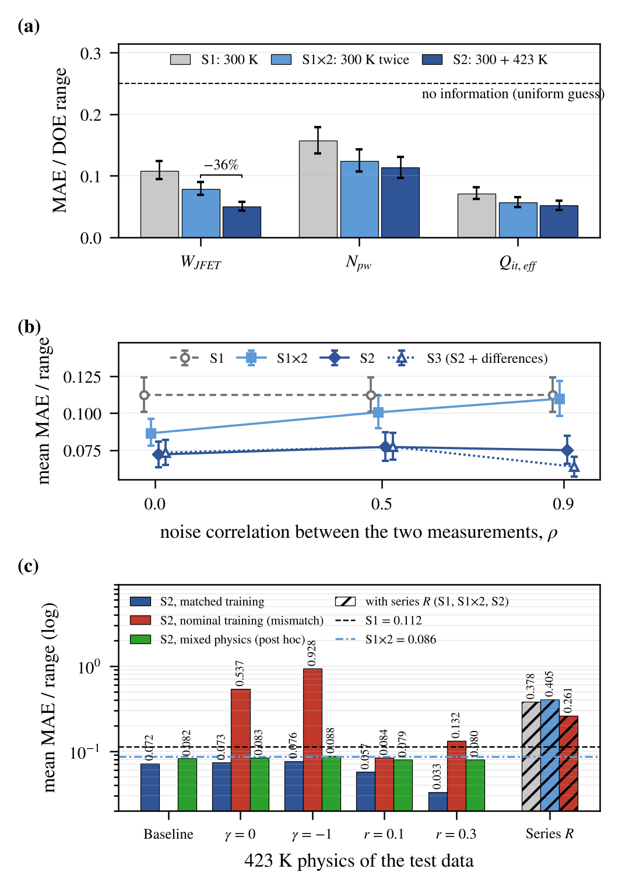
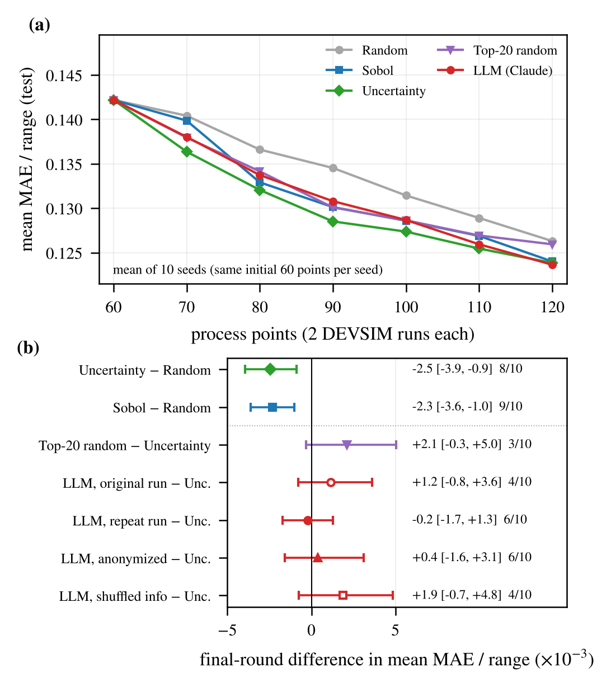

# DEVSIM 기반 4H-SiC 평판형 MOSFET 공정 결과 파라미터의 다중 온도 역추정과 LLM 보조 TCAD 표본 선택 평가

**Multi-Temperature Inverse Estimation of Process-Outcome Parameters and Evaluation of LLM-Assisted TCAD Sample Selection for 4H-SiC Planar MOSFETs Using DEVSIM**

[](https://github.com/mseokq23/sic-mosfet-devsim/actions/workflows/ci.yml?query=branch%3Aexp%2Fv4.7-controls)
[](LICENSE)
[](environment.txt)
[](environment.txt)

**이민석 (Minseok Lee)** · 광운대학교 전자공학과 (Department of Electronic Engineering, Kwangwoon University) · minseok1270@gmail.com

> **브랜치 안내.** 논문 원고 V4.9(2026-10-10)의 코드·원자료·분석 결과는 **이 브랜치 `exp/v4.7-controls`** 에 있습니다.
> 논문이 인용한 결과 커밋 [`90134a2`](https://github.com/mseokq23/sic-mosfet-devsim/tree/90134a2)와 분석 계획 커밋 `f542405`·`ae73669`·`cb3534b`는 모두 이 브랜치의 이력에 있습니다.
> `main`은 원고 V4.6a 시점(`a2837f9`)으로, 반복 측정 통제(S1×2)와 RQ3 절제 결과가 없습니다.
> 저장된 결과를 그림으로 둘러보려면 [결과 리포트](#결과-리포트)를 여십시오.

---

## Abstract

This repository accompanies the paper above (manuscript V4.9). Using DC characteristics of a 4H-SiC planar MOSFET simulated with DEVSIM at 300 K and 423 K, we estimate three latent process-outcome parameters (JFET width, P-well doping and effective interface charge) with a Gaussian-process model under assumed measurement noise. Adding the 423 K features lowered the normalized error from 0.112 to 0.072, but measuring the 300 K features twice already gave 0.086, so about two thirds of the gain came from the extra measurement. The temperature-specific remainder (−0.014 vs. the repeated measurement, 95% CI −0.024 to −0.006) was concentrated in the JFET width and persisted under correlated measurement noise and at an equal simulation budget. It was clear only when the high-temperature physics was known: a wrong channel-mobility temperature exponent raised the error to 0.54 and 0.93, above the no-information level of 0.25, and training that covered all five physics assumptions avoided this failure but showed no statistically established gain over the repeated measurement. In a retrospective pool-based evaluation, uncertainty sampling needed 12–20% fewer simulations than random sampling, but a Sobol sequence performed comparably. An LLM-assisted selector passed structured-output validation in 238 of 240 calls and followed the numbers it was given, as shuffled inputs redirected its choices; with 10 seeds, however, it showed no advantage over uncertainty sampling.

## 국문 요약

DEVSIM으로 계산한 4H-SiC 평판형 MOSFET의 300 K·423 K DC 특성에서 JFET 폭, P-well 도핑, 유효 계면전하를 가우시안 과정으로 역추정하였다. 측정 잡음을 넣었을 때 423 K 특징을 더하면 정규화 오차가 0.112에서 0.072로 줄었다. 그러나 300 K를 두 번 측정해도 0.086이어서, 이득의 약 2/3는 측정 횟수에서 나왔다. 나머지 온도 고유 이득(반복 측정 대비 −0.014, 95% CI −0.024~−0.006)은 JFET 폭에 집중되었고, 측정 간 잡음 상관과 같은 시뮬레이션 예산에서도 유지되었다. 다만 이 이득은 고온 물리를 알 때만 뚜렷하였다. 채널 이동도 온도지수를 틀리게 가정하면 오차가 0.54, 0.93으로 커졌고, 다섯 가정을 모두 포함해 학습하면 이 실패는 피했지만 반복 측정보다 낫다는 통계적 근거는 없었다. 회고적 풀 평가에서 불확실도 선택은 무작위보다 시뮬레이션을 12~20% 줄였으나 Sobol 순서도 비슷하였다. LLM 보조 선택은 제공된 수치를 따랐지만, 시드 10개에서 불확실도 선택보다 나은 결과는 확인되지 않았다.

<p align="center">
  
</p>
<p align="center"><sub><b>논문 그림 1.</b> (a) 4H-SiC 평판형 MOSFET half-cell 단면(half-pitch 3.5 µm·채널 길이 0.5 µm 고정, 드리프트층 축약 표시)과 추정 파라미터, (b) 다중 온도 시뮬레이션–특징 추출–역추정 및 표본 선택 흐름</sub></p>

## 목차

[연구 질문](#연구-질문) · [주요 결과](#주요-결과) · [결과 리포트](#결과-리포트) · [방법 요약](#방법-요약) · [모델 검증](#모델-검증) · [재현 가이드](#재현-가이드) · [논문–산출물 대응표](#논문산출물-대응표) · [디렉터리 구조](#디렉터리-구조) · [데이터 형식](#데이터-형식) · [분석 계획과 실행 기록](#분석-계획과-실행-기록) · [타당성에 대한 위협](#타당성에-대한-위협) · [LLM 사용 범위](#llm-사용-범위) · [환경과 계산량](#환경과-계산량) · [인용](#인용)

## 연구 질문

| 구분 | 질문 |
|---|---|
| RQ1 | 423 K 특징이 역추정 오차를 얼마나 줄이는가? 그 가운데 300 K 반복 측정으로 설명되지 않는 부분(온도 고유 이득)은 무엇이며, 고온 물리 가정에 어떻게 의존하는가? |
| RQ2 | 미리 계산한 후보 풀에서 회고적으로 평가한 적응형 표본 선택이 필요한 시뮬레이션 수를 줄이는가? |
| RQ3 | 결정론적 검증기로 제한한 LLM 보조 선택이 수치적 불확실도 선택보다 나은가? LLM은 제공한 정보를 실제로 쓰는가? |

## 주요 결과

기본 잡음, 가우시안 과정(GP) 역추정, 독립 시험점 128개 기준입니다. MAE<sub>norm</sub>은 세 파라미터의 절대오차를 각 DOE 범위로 나눠 평균한 값이고, 범위 중앙값을 답하는 무정보 추정은 0.25입니다. 괄호의 구간은 시험점 짝지은 부트스트랩(5,000회) 95% CI이며, 능동학습 비교는 시드 10개의 짝지은 부트스트랩입니다.

| 논문 위치 | 결과 | 근거 파일 |
|---|---|---|
| 초록, 4.1절, 그림 3(a) | S1 0.112, S1×2 0.086, S2 0.072. S2−S1 [−0.049, −0.031], S1×2−S1 −0.026(변수별 비 0.73–0.80) | [`v47_repeat_control.md`](results/summary/v47_repeat_control.md) |
| 초록, 4.1절 | 온도 고유 이득 S2−S1×2 −0.0145 [−0.0237, −0.0060], W<sub>JFET</sub> 0.079→0.050 [−0.040, −0.017]; N<sub>pw</sub>·Q<sub>it,eff</sub>는 CI가 0 포함 | 같은 파일 |
| 4.1절 | 34차원 통제 S1×2cat 0.091, 2배 잡음·Ridge·다른 잡음 실현 4개에서도 같은 결론, CRB 비 S2/S1 0.38/0.59/0.58 | 같은 파일 |
| 4.1절, 그림 3(b) | 잡음 상관 ρ = 0.5, 0.9에서 S1×2 0.101, 0.110, S2 0.077, 0.075, S3 0.064(ρ = 0.9) | 같은 파일 |
| 4.1절 | 같은 DEVSIM 120회: S2(60점) 0.085, S1(120점) 0.127, S1×2(120점) 0.096. 480회: S1 0.113, S1×2 0.087 | [`v48_extra_stats.md`](results/summary/v48_extra_stats.md) 2절, [`rq1_equal_budget.md`](results/summary/rq1_equal_budget.md) |
| 표 2, 4.2절 | 같은 물리로 학습: 0.072/0.073/0.076/0.057/0.033(S1×2 대비 −17~−62%, CI 모두 0 미만) | [`v48_extra_stats.md`](results/summary/v48_extra_stats.md) 1절, [`robustness.md`](results/summary/robustness.md) |
| 표 2, 4.2절 | 기준 물리(γ = +1, r = 0)로 학습: γ = 0 0.537, γ = −1 0.928(범위 제한 0.388, 0.449), r = 0.1 0.084, r = 0.3 0.132 | 같은 파일 |
| 표 2, 4.2절 | 가정 무작위화 학습(사후): 0.079–0.088, S1×2와의 차이 CI 모두 0 포함 | [`robustness_mixed.md`](results/summary/robustness_mixed.md), [`v48_extra_stats.md`](results/summary/v48_extra_stats.md) |
| 표 2, 4.2절 | 기생 직렬저항(탐색적): S1 0.378, S1×2 0.405, S2 0.261 | [`v47_repeat_control.md`](results/summary/v47_repeat_control.md) |
| 4.3절, 그림 4 | 불확실도−무작위 −0.0025 [−0.0039, −0.0009], 약 106점에서 도달(12% 절감); 초기 30·90점 20%·15%; Sobol 24%·7%·9%; 불확실도−Sobol −0.0002 [−0.0013, +0.0009] | [`rq2.md`](results/summary/rq2.md), [`al_ninit_summary.csv`](results/summary/al_ninit_summary.csv), [`v48_extra_stats.md`](results/summary/v48_extra_stats.md) 3절 |
| 표 3, 4.4절 | 최종 오차 A0 0.1250, A 0.1236, B 0.1242, C 0.1257, D 0.1259, 불확실도 0.1238; 모든 조건에서 불확실도와 차이 CI가 0 포함 | [`v47_rq3_ablation.md`](results/summary/v47_rq3_ablation.md) |
| 표 3, 4.4절 | 검증 통과 A0 59/60, A·B·C 60/60/59(합계 238/240); C의 선택은 표시된 상위 10과 64%, 실제 상위 10과 49% 겹침, 틀리게 표시한 최악 변수 방향 확대 51/59 | 같은 파일, [`llm_calls.jsonl`](results/al_v47/shuffled/nominal/llm_calls.jsonl) |
| 4.4절 | 최소 검출 차이(검정력 0.8) 0.0025–0.0047, A0−A 0.0014, A−D −0.0023 [−0.0043, −0.0004], t 구간은 0 포함 | [`v48_extra_stats.md`](results/summary/v48_extra_stats.md) 3절 |

<p align="center">
  
</p>
<p align="center"><sub><b>논문 그림 3.</b> 역추정 오차(시험 128점, GP): (a) 변수별 S1, S1×2, S2, (b) 두 측정의 잡음 상관 ρ에 따른 평균 오차, (c) 시험 시나리오별 S2 평균 오차(로그축)</sub></p>

<p align="center">
  
</p>
<p align="center"><sub><b>논문 그림 4.</b> 회고적 풀 평가의 표본 선택 정책 비교(S2, RF, 시드 10개, 같은 환경): (a) 학습곡선, (b) 최종 라운드의 짝지은 차이</sub></p>

## 결과 리포트

[`docs/report/index.html`](docs/report/index.html)은 저장된 결과 파일만 읽어 만든 대화형 리포트입니다(모델 학습·DEVSIM·API 호출 없음). 그림마다 읽은 파일을 적고 같은 값을 표로도 보여 주며, 마지막 절에 읽은 파일 33개의 크기와 SHA-256을 남깁니다.

| 절 | 내용 |
|---|---|
| 요약 | 초록의 핵심 수치(S1·S1×2·S2, 온도 고유 이득, 고온 물리 불일치, RQ2·RQ3, DEVSIM run 수) |
| 소자 특성 | 기준 소자와 변수별 ±20% I–V(300/423 K), 시험 소자 128개의 I–V와 423 K 물리 변형 네 가지, 표 1 |
| RQ1 | 변수별 S1/S1×2/S2와 95% CI, 잡음 상관 ρ, 시험점별 짝지은 산점도, 같은 DEVSIM 예산 |
| 고온 물리 | 시나리오별 S2 오차(같은 물리·기준 물리·가정 무작위화 학습), 표 2, 423 K 특징 변화, 직렬저항 |
| RQ2·RQ3 | 학습곡선(시드 ±SD 선택), 최종 차이 숲 그림과 시드 수준 통계, 초기 표본 수 |
| LLM 호출 | 조건별 요약, 호출 하나에서 보여 준 후보와 고른 후보(C는 섞기 전 실제 값과 비교), 호출 240회 전체 |

```bash
python scripts/make_report.py                  # docs/report/index.html 다시 만들기(약 2초)
python -m http.server 8000 --directory docs    # Codespaces: Ports 탭에서 8000을 열고 /report/ 로 이동
```

- 그래프는 plotly.js(2.35.2, jsDelivr)를 불러와 그립니다. 인터넷 없이 보려면 `pip install -r requirements-viz.txt` 후 `python scripts/make_report.py --embed-plotly`로 plotly.js를 파일 안에 넣습니다.
- **GitHub Pages로 공개:** Settings → Pages → Build and deployment에서 Source를 *Deploy from a branch*, 브랜치를 `exp/v4.7-controls`, 폴더를 `/docs`로 저장하면 `https://mseokq23.github.io/sic-mosfet-devsim/report/`에서 열립니다(`docs/index.html`이 이 주소로 안내). 비공개 저장소의 Pages는 GitHub Pro·Team·Enterprise 플랜에서만 쓸 수 있습니다.
- 결과 파일을 다시 계산한 뒤 리포트를 만들면, 머리말의 "결과 데이터 커밋" 옆에 미커밋 변경이 표시됩니다.

## 방법 요약

### 소자와 물리 모델

| 항목 | 설정 |
|---|---|
| 구조 | 1.2 kV급 설계를 참고한 2차원 평판형 half-cell (half-pitch 3.5 µm, 채널 길이 0.5 µm, 게이트 산화막 50 nm) |
| 도핑 | P-well 1×10<sup>17</sup>, JFET 2×10<sup>16</sup>, 드리프트 10 µm·1×10<sup>16</sup> cm<sup>−3</sup> |
| 수송 | Poisson + 전자 연속방정식(Scharfetter–Gummel), 정공은 소스/바디와 평형인 단극성 근사 |
| 물리 | 불완전 이온화(N 66 meV, Al 191 meV), 도핑·온도 의존 이동도(Roschke–Schwierz), SRH 재결합, 정적 계면전하 |
| 메시·정밀도 | medium 메시(약 1.1만 노드), 배정밀도, 상대 허용오차 10<sup>−6</sup> |
| 제외 | 충돌 이온화, 자기발열, 산화막 열화, Fermi–Dirac 통계, 전계 의존 이동도, 동적 계면 트랩 |

채널 이동도와 계면전하는 다음과 같이 두었습니다. 기준 모델은 γ = +1, r = 0이며, 나머지 값은 강건성 시험에만 씁니다.

$$
\mu_n^{-1} = \mu_{\mathrm{bulk}}^{-1}(N,T) + e^{-y/\lambda}\,\mu_{\mathrm{surf}}^{-1}(T),\qquad
\mu_{\mathrm{surf}}(T) = 20\,s_\mu\left(\frac{T}{300\ \mathrm{K}}\right)^{\gamma}\ \mathrm{cm^2/(V\,s)},\quad \gamma\in\{+1,0,-1\}
$$

$$
\sigma_{\mathrm{int}} = q\left[Q_f + Q_{\mathrm{it,eff}}(T)\right],\qquad
Q_{\mathrm{it,eff}}(T) = Q_{\mathrm{it,eff}}(300\ \mathrm{K})\left[1 - r\,\frac{T-300\ \mathrm{K}}{123\ \mathrm{K}}\right],\quad r\in\{0,\,0.1,\,0.3\}
$$

λ = 3 nm, Q<sub>f</sub> = 1×10<sup>12</sup> cm<sup>−2</sup>(고정)입니다. 추정 대상은 300 K에서 정의한 Q<sub>it,eff</sub>이고, γ와 r은 역추정 모델에 입력하지 않습니다. 동결 설정은 [`configs/baseline.yaml`](configs/baseline.yaml)(v1.1-frozen), 변형은 [`configs/variants/`](configs/variants/)에 있습니다.

### 추정 파라미터, 특징, 잡음

| 변수 | 범위 | 역할 |
|---|---|---|
| W<sub>JFET</sub> 배율 | 0.8–1.2 (기준 2.4 µm, 마스크 피치 고정, 자기정렬 경계 이동) | 추정 대상 |
| N<sub>pw</sub> 배율 | 0.8–1.2 (기준 1×10<sup>17</sup> cm<sup>−3</sup>) | 추정 대상 |
| Q<sub>it,eff</sub> | −1.5 ~ −0.5 ×10<sup>12</sup> cm<sup>−2</sup> | 추정 대상 |
| s<sub>μ</sub> (채널 이동도 배율) | 0.8–1.2 | 교란 변수(모든 설계에서 바뀌지만 추정하지 않음) |

- **특징(온도당 17개):** 스칼라 6개(V<sub>th</sub>(1×10<sup>−4</sup> A/cm 정전류), SS(10<sup>−10</sup>~10<sup>−6</sup> A/cm), log g<sub>m,max</sub>, log I<sub>on</sub>(V<sub>GS</sub> = 18 V), log R<sub>on,sp</sub>(V<sub>DS</sub> ≤ 0.5 V 기울기), log I<sub>D</sub>(V<sub>DS</sub> = 2 V))와 전달곡선 표본 11개(V<sub>GS</sub> = 4, 5, 6, 7, 8, 10, …, 20 V의 log I<sub>D</sub>). 전류는 단위 폭당 값(A/cm)입니다.
- **특징 집합:** S1 = 300 K(17차원), S2 = 300+423 K(34차원), S3 = S2 + 온도차(51차원). 반복 측정 통제 **S1×2** = 300 K 특징에 독립 잡음을 한 번 더 실현해 평균한 17차원(두 번째 실현 시드는 동결 시드 + 1000), 보조 통제 S1×2cat = 두 실현을 나란히 둔 34차원.
- **측정 잡음(특징 단계):** V<sub>th</sub> 10 mV, SS·g<sub>m,max</sub> 2%, I<sub>on</sub>·R<sub>on,sp</sub>·I<sub>D</sub>(2 V) 1%, 전달곡선 표본 2%. 표본 전류는 잡음 후 1×10<sup>−11</sup> A/cm에서 절단하고, 풀과 시험 집합에는 서로 다른 고정 시드를 씁니다([`noise_model.yaml`](configs/noise_model.yaml), noise-v1.1). 두 측정 사이의 잡음 상관은 z<sub>2</sub> = ρz<sub>1</sub> + (1 − ρ<sup>2</sup>)<sup>1/2</sup>z′로 둡니다(ρ ∈ {0, 0.5, 0.9}).

$$
\mathrm{MAE_{norm}} = \frac{1}{3}\sum_{j=1}^{3}\frac{1}{N}\sum_{i=1}^{N}\frac{\lvert\hat\theta_{ij}-\theta_{ij}\rvert}{\theta_j^{\max}-\theta_j^{\min}}
$$

### 실험 설계

- **명목 데이터:** 4차원 Sobol 풀 512점(seed 2026), 독립 무작위 시험점 128점(seed 12345), 각 300/423 K (1,280 run).
- **역추정 모델:** GP(상수×RBF + 백색잡음), 랜덤 포레스트(300그루), Ridge. GP·Ridge의 입력은 표준화하고 출력은 DOE 범위로 [0, 1] 정규화합니다. RQ1 표([`rq1.md`](results/summary/rq1.md))의 extra trees는 논문에 쓰지 않은 보조 결과입니다.
- **강건성 시험:** 423 K만 다시 계산(γ = 0, −1; r = 0.1, 0.3; 각 640점, 2,560 run). ① 같은 물리로 학습·평가, ② 기준 물리로 학습하고 변형 물리로 평가, ③ 512점의 423 K 데이터를 다섯 가정에서 무작위로 가져와 학습(가정 무작위화 학습, 사후 분석).
- **기생 직렬저항(탐색적):** 소자별 R<sub>s,sp</sub> ~ U(0.1, 0.3) mΩ·cm<sup>2</sup>를 드레인 측 집중저항 R<sub>s</sub> = R<sub>s,sp</sub>/W<sub>c</sub>(W<sub>c</sub> = 3.5 µm)로 두고 저장 곡선을 1차 근사로 변환해 시험 데이터에만 넣습니다.
- **회고적 풀 평가(RQ2):** 초기 무작위 60점 + 10점 × 6라운드, S2 특징·RF 역추정, 시드 10개. 불확실도 정책은 순방향 RF(200그루)의 트리 간 표준편차 u(p)를 구하고, u 상위 30개에서 u(p)·d(p)가 최대인 점을 10회 순차 선택합니다(d는 학습점과 이미 고른 점까지의 최소 거리). 무작위와 Sobol 순서는 학습 모델을 쓰지 않는 기준선입니다.

$$
p^{*} = \arg\max_{p}\; u(p)\, d(p,\ \mathcal{D}\cup\mathcal{B})
$$

- **LLM 보조 선택(RQ3):** u 상위 20개 후보의 정규화 설계값·u·d와 학습 데이터 5겹 교차검증 오차를 Claude(`claude-sonnet-5-5`, 기본 샘플링 온도)에 주고 10개와 사유 코드를 JSON 스키마 구조화 출력으로 받습니다. 절제 조건은 A(원래 형식, 재실행), B(변수명 x1–x4·물리 설명 제거), C(라운드마다 (u, d) 쌍을 섞고 변수별 오차를 순환 이동), D(LLM 없이 상위 20개 중 무작위 10개)이고, A0는 같은 조건의 1차 실행입니다.

## 모델 검증

| 단계 | 내용 | 판정 기준 | 결과 | 기록 |
|---|---|---|---|---|
| Gate 0 | DEVSIM 2.11.0 + MKL, 공식 1D diode 예제 2회 실행 | 출력 동일 | PASS (CI에서 push마다 확인) | [`gate0_check.py`](scripts/gate0_check.py) |
| Gate 1 | 1D 4H-SiC PN 다이오드, 300/423 K | 해석해 | 내장전위 소수점 넷째 자리까지 일치, 공핍폭 1.5% 이내 | [`gate1_pn_diode.json`](results/pretest/gate1_pn_diode.json) |
| Gate 2 | 1D MOS 커패시터 | 평탄대 전압 해석해 | 오차 ≤ 5 mV, ±10<sup>12</sup> cm<sup>−2</sup> 전하에 ΔV<sub>fb</sub> ≈ ∓2.32 V(이론 ∓2.320 V) | [`gate2_moscap.json`](results/pretest/gate2_moscap.json) |
| Gate 3 | 2D MOSFET half-cell (300 K) | [`sweep_protocol.yaml`](configs/sweep_protocol.yaml) 허용오차 | medium 대 fine: V<sub>th</sub> 0.07 mV, SS 0.1%, g<sub>m</sub> 2.7%, I<sub>on</sub>·R<sub>on</sub> 0.9%; 배정밀도 대 128비트 V<sub>th</sub> 2×10<sup>−11</sup> V; 2회 실행 비트 단위 동일 | [`gate3_summary.json`](results/pretest/gate3_summary.json) |
| 풀 감사 | 해석 기울기 dV<sub>th</sub>/dQ<sub>it</sub>, 설계↔run 대응, 특징 재추출 | −q/C<sub>ox</sub> | −2.32005 V (이론 −2.319888 V, 10<sup>12</sup> cm<sup>−2</sup>당) | [`AUDIT.md`](docs/AUDIT.md) |

- Gate 3 결과 파일은 사전 시험 단계(`baseline-v0.2-pretest`)에 저장되어, V<sub>th</sub>가 0.25 V 격자 보간으로 뽑은 값(3.772 V)입니다. 이후 V<sub>th</sub>를 목표 전류의 게이트 전압을 다시 풀어 구하는 보정 추출로 바꿨습니다. 동결 설정(v1.1)으로 같은 사례를 다시 계산하면 I–V 곡선은 기록과 비트 단위로 같고, 보정 추출 V<sub>th</sub>는 논문 2.3절 값 3.765 V, medium·fine 차이는 V<sub>th</sub> 0.03 mV, R<sub>on,sp</sub> 0.87%입니다([`REPRO_CHECK.md`](docs/REPRO_CHECK.md)).
- v1.1 기준 소자는 300 K→423 K에서 V<sub>th</sub> 3.765→3.530 V, SS 112.5→155.7 mV/dec, R<sub>on,sp</sub> 2.00→2.87 mΩ·cm<sup>2</sup>입니다([`stage_a_v11`](results/stage_a_v11/)).

## 재현 가이드

### 재현 수준

| 수준 | 내용 | 필요 자원 (측정값) | 시작점 |
|---|---|---|---|
| L0 | 저장된 결과·감사 문서·리포트 확인 | 브라우저 | [`results/summary/`](results/summary/), [`docs/`](docs/), [결과 리포트](#결과-리포트) |
| L1 | 저장된 원자료에서 모든 표·그림 수치 다시 계산 (DEVSIM·API 없음) | Python, 1코어 약 10분(능동학습 재실행 포함 시 약 30분) | `bash scripts/reproduce_l1.sh` |
| L2 | 소자 수준 검증(Gate 0–3)과 저장된 run의 재시뮬레이션 비교 | DEVSIM + MKL, run당 약 1분 | `python scripts/rerun_check.py` |
| L3 | 전체 DOE 재계산(명목 1,280 + 강건성 2,560 run) | 약 50 코어·시간 (GitHub Actions 병렬 권장) | [L3](#l3--전체-doe-재계산) |

RQ3의 실제 LLM 호출은 API 키와 비용이 필요하고 응답이 비트 단위로 재현되지 않으므로, 논문 결과의 기준 기록은 저장된 `llm_calls.jsonl`(A0: [`results/al_live/nominal/`](results/al_live/nominal/), A·B·C: [`results/al_v47/`](results/al_v47/))입니다.

### 환경 준비

**GitHub Codespaces (권장, 논문 실행 환경).** 저장소 화면에서 브랜치를 `exp/v4.7-controls`로 바꾼 뒤 **Code → Codespaces → Create codespace on exp/v4.7-controls**(4-core)를 누릅니다. `postCreate`가 의존성 설치(MKL 포함), editable 설치, Gate 0 점검을 수행하고, 이 Codespace의 패키지 목록을 `environment.local.txt`(git 제외)에 기록합니다. 커밋된 [`environment.txt`](environment.txt)는 논문 실행 환경의 기록이므로 바꾸지 않습니다.

**로컬 Linux.**

```bash
git clone -b exp/v4.7-controls https://github.com/mseokq23/sic-mosfet-devsim.git
cd sic-mosfet-devsim
python3.12 -m venv .venv && source .venv/bin/activate
pip install -r requirements.txt && pip install -e .
export MKL_NUM_THREADS=1 OMP_NUM_THREADS=1      # 모든 결과는 단일 스레드로 계산
```

설치 확인(약 30초): `pytest -q`(52개 통과)와 `python scripts/gate0_check.py`(`official diode_1d x2: PASS`). DEVSIM은 MKL이 없으면 import에 실패합니다. 검증에 쓴 정확한 패키지 버전은 [`environment.txt`](environment.txt)에 있고, CI 배지는 단위 시험과 Gate 0의 상태입니다.

### L1 · 한 번에 다시 계산하고 비교하기

```bash
bash scripts/reproduce_l1.sh              # 분석·요약·그림·리포트, 1코어 약 10분
bash scripts/reproduce_l1.sh --with-al    # 능동학습(run_al 3회, al_ninit)까지, 약 30분
```

현재 커밋의 임시 worktree에서 아래 명령을 차례로 실행하고, 다시 만든 파일을 커밋된 파일과 비교해 표로 보여 줍니다([`scripts/compare_outputs.py`](scripts/compare_outputs.py)). 작업 중인 폴더는 바뀌지 않습니다. 커밋하지 않은 변경은 worktree에 들어가지 않으므로 먼저 커밋합니다.

### L1 · 단계별 명령

분석 스크립트는 `results/`와 `paper/` 안의 파일을 덮어씁니다. 제자리에서 실행했다면 `python scripts/compare_outputs.py`로 차이를 확인하고 `git checkout -- results paper`로 되돌립니다. 시간은 1코어(Intel Xeon 2.1 GHz) 측정값입니다.

| 순서 | 명령 | 출력 | 논문 위치 | 시간 |
|---|---|---|---|---|
| 1 | `python scripts/audit_results.py results/pool configs/design_pool.csv results/test configs/design_test.csv` | `results/pool/audit.json` | 3.5절(재현성 점검) | < 20 s |
| 2 | `python scripts/stage_a_report.py results/stage_a_v11` | `results/stage_a_v11/stage_a_deltas.csv`, `stage_a_summary.json`, `fig_stage_a.png` | 표 1, 3.1절 | 6 s |
| 3 | `python scripts/identifiability.py results/stage_a_v11` | `results/stage_a_v11/identifiability_nominal.json` | 4.1절(CRB) | 2 s |
| 4 | `python scripts/repeat_control.py` | `results/summary/v47_repeat_control.{md,json}`, `v47_repeat_control_points.csv` | 초록, 4.1절, 그림 3(a·b) | 2 min |
| 5 | `python scripts/robustness.py` | `results/summary/robustness.{md,json}` | 표 2, 4.2절 | 1.5 min |
| 6 | `python scripts/robustness_mixed.py` | `results/summary/robustness_mixed.{md,json}`, `paper/tables/table2_robustness.*` | 표 2(가정 무작위화) | 1.7 min |
| 7 | `python scripts/v48_extra_stats.py` | `results/summary/v48_extra_stats.{md,json}` | 표 2(S1×2 대비), 같은 예산, 시드 수준 통계 | 1 min |
| 8 | `python scripts/rq3_ablation.py` | `results/summary/v47_rq3_ablation.{md,json}` | 표 3, 4.4절 | 1 min |
| 9 | `python scripts/run_al.py --pool results/pool --test results/test --seeds 10 --noise <none\|nominal\|high>` | `results/al/<noise>/` (`al_curves.csv`, `rq1_feature_sets.json`, dry-run LLM 로그) | 4.3절 | 각 4.5 min |
| 10 | `python scripts/summarize_results.py` | `results/summary/rq1.md`, `rq1_equal_budget.md`, `rq2.md`, `rq3.md`, `fig_*.png` | 4.1·4.3절 | 16 s |
| 11 | `python scripts/al_ninit.py --n-init 30 90 --seeds 10` | `results/summary/al_ninit_curves.csv`, `al_ninit_summary.csv` | 4.3절(초기 표본 수) | 3.5 min |
| 12 | `python scripts/ridge_rq1.py` | `results/summary/ridge_rq1.json` | 4.1절(선형 Ridge) | 2 s |
| 13 | `python scripts/make_paper_figures.py` | `paper/figures/fig1_*`, `fig2_*`, `paper/tables/table1_*` (+ V4.6a의 `fig3_rq1`, `fig4_policies`, `paper/captions.md`) | 그림 1·2, 표 1 | 27 s |
| 14 | `python scripts/make_v47_figures.py` | `paper/figures/fig3_rq1_v47`, `fig3_rq1_robust_v47`, `fig4_policies_v47`, `v47_figure_notes.json` | 그림 3·4 | 5 s |
| 15 | `python scripts/make_report.py` | `docs/report/index.html` | 리포트 | 2 s |

- 9는 저장된 `results/al/`을 다시 만들고, 10과 11은 그 곡선을 읽습니다. 8은 `results/al_v47/`과 `results/al/nominal/`을 읽습니다. 9를 건너뛰면 8·10·11은 커밋된 곡선으로 계산합니다.
- `results/al/`의 `llm` 정책은 API 없이 규칙으로 고르는 dry-run 대역이며 논문 결과가 아닙니다. 논문의 LLM 결과는 `results/al_live/`(A0)와 `results/al_v47/`(A·B·C)입니다.
- 그 밖의 스크립트: `make_fig3_robust.py`(V4.6a 그림 3), `make_slide_figures.py`(발표용 `paper/slides/`), `rq3_diversity.py`(A0 선택 통계 출력), `make_pretest_report.py`(사전 시험 문서).

### 다시 계산한 값의 일치 수준

2026-10-11에 논문 실행 CPU(AMD EPYC 7763)와 다른 Intel Xeon 2.1 GHz에서(Python 3.12, 같은 패키지 버전) 위 명령을 모두 실행해 확인한 결과입니다. 자세한 기록은 [`docs/REPRO_CHECK.md`](docs/REPRO_CHECK.md)에 있습니다.

| 대상 | 결과 |
|---|---|
| GP·Ridge 분석(RQ1, 반복 측정 통제, 강건성, 사후 비교) | JSON·CSV의 마지막 자릿수만 다름(절대 차이 ≤ 5×10<sup>−7</sup>). Markdown 요약표와 논문에 인용한 수치는 모두 같음 |
| RQ3 절제 요약(`rq3_ablation.py`) | 저장된 로그에서 같은 값(커밋·시각 메타데이터만 다름) |
| 능동학습 곡선(`run_al.py`) | 무작위·Sobol 정책은 같음. 불확실도 정책과 dry-run LLM은 라운드 1부터 달라짐: 불확실도 최종 0.1238 → 0.1242, 무작위 대비 −0.0025 [−0.0039, −0.0009] → −0.0021 [−0.0041, +0.0003] |
| 초기 표본 수(`al_ninit.py`) | 초기 30·90점 결과는 Intel에서 같은 값, 초기 60점은 `results/al/nominal`(AMD 실행)을 읽으므로 9를 다시 실행하면 함께 바뀜 |
| RQ3 A0 재생(`--replay-log`) | 후보 목록이 달라 payload 해시 0/60 일치, A0 곡선은 재현되지 않음(같은 CPU 종류에서만 재현) |
| 저장된 run 재시뮬레이션(`rerun_check.py`) | T0000(300·423 K), T0001(423 K), γ = 0 변형 T0002: 물리·솔버·메시 해시 일치, 특징 상대 차이 ≤ 6×10<sup>−16</sup>, 곡선은 일부 점에서 ≤ 2×10<sup>−12</sup> |
| 원고 빌드 | `docx` 9.7.1로 V4.9 두 판을 다시 만들면 본문 텍스트가 커밋된 docx와 같음 |
| 형식 차이 | 현재 `summarize_results.py`는 `rq2.md` 머리말을 "dry-run"으로, `al_ninit.py`는 CI를 `ci_lo`·`ci_hi` 열과 `al_ninit_curves.csv`(커밋된 파일명은 `al_ninit_curves_n30_n90.csv`)로 저장 |

능동학습 곡선이 CPU에 따라 달라지는 것은 순방향 RF 대리 모델의 후보 순위가 마지막 자릿수 차이로 바뀌기 때문으로 보입니다([`PREDICTIONS_V47.md`](docs/PREDICTIONS_V47.md)에 실행 전 기록). RQ2·RQ3의 기준 값은 커밋된 곡선이고, 같은 CPU 종류(GitHub Codespaces의 AMD EPYC 7763)에서 다시 실행하면 그대로 재현됩니다(v4.7 실행에서 불확실도 곡선 최대 차이 0). 같은 비교 안의 정책은 반드시 한 환경에서 실행합니다.

### L2 · 소자 검증과 run 재계산

```bash
python scripts/gate1_pn_diode.py         # 11 s → results/pretest/gate1_pn_diode.json
python scripts/gate2_moscap.py           # 9 s  → results/pretest/gate2_moscap.json
python scripts/gate3_mosfet.py && python scripts/gate3_report.py
python scripts/rerun_check.py            # 시험점 T0000을 300·423 K에서 다시 계산해 저장값과 비교(약 1분)
python scripts/rerun_check.py --set results/test_gamma0 --config configs/variants/gamma0.yaml --temps 423
```

- `gate3_mosfet.py`는 이미 있는 사례를 건너뜁니다. 다시 계산하려면 `results/pretest/gate3/<사례>.json`을 옮긴 뒤 사례 이름을 인자로 주십시오(예: `python scripts/gate3_mosfet.py ms1.5_dp_300`, medium 약 1분·fine 약 2분). 다시 계산한 곡선은 기록과 같고, V<sub>th</sub>만 보정 추출 값(기록보다 7 mV 낮음)으로 저장됩니다([모델 검증](#모델-검증)).
- `rerun_check.py`는 임시 폴더에 계산하므로 `results/`를 바꾸지 않습니다. 해시가 다르거나 특징 차이가 10<sup>−9</sup>을 넘으면 종료 코드 1을 돌려줍니다.

### L3 · 전체 DOE 재계산

```bash
python -m sicsim.runner configs/design_pool.csv --out results/pool --jobs 4 --budget-s 20000
python -m sicsim.runner configs/design_test.csv --out results/test --jobs 4
python -m sicsim.runner configs/design_test.csv --out results/test_gamma0 --jobs 4 --temps 423 --config configs/variants/gamma0.yaml
```

- 러너는 run마다 JSON을 즉시 저장하므로 같은 명령으로 중단 지점부터 이어서 계산합니다. `--shard i/N`은 N개 중 i번째 몫만 계산합니다.
- 논문의 명목 데이터는 GitHub Actions `doe-batch` 워크플로(pool run `37091586917`, test run `37091765653`), 강건성 데이터는 `robustness-batch` 워크플로(run `37164222148`)로 계산했습니다. **Actions → robustness-batch → Run workflow**는 네 변형의 423 K 결과를 shard로 나눠 계산하고 병합·분석·커밋까지 수행합니다(300 K는 명목 데이터를 재사용).

### RQ3 · LLM 실행

```bash
python scripts/llm_check.py                     # 호출 1회로 키·모델·구조화 출력 확인
bash scripts/v47_run_all.sh llm                 # A·B·C 조건 각 60회(약 30–40분, 결과는 results/al_v47/<조건>/)
python scripts/run_al.py --pool results/pool --test results/test --seeds 10 --noise nominal \
  --policies llm --replay-log results/al_live/nominal/llm_calls.jsonl --out /tmp/replay_A0   # API 없이 A0 재생
```

- API 키는 `ANTHROPIC_API_KEY` 또는 Codespaces secret `MSEOKQ_CLAUDE`에서 읽습니다([`.env.example`](.env.example)). 키가 없거나 재시도 후에도 호출이 실패하면 dry-run으로 넘어가지 않고 멈춥니다.
- 실시간 실행은 비결정적이므로 새로 실행한 값은 논문 값과 다릅니다. 기존 로그가 있는 폴더는 `--overwrite` 없이 덮어쓰지 않습니다. `v47_run_all.sh`는 브랜치가 `exp/v4.7-controls`가 아니면 경고만 출력합니다.
- 재생(`--replay-log`)은 저장된 응답을 같은 (시드, 라운드)에 다시 넣습니다. 후보 목록이 논문 실행과 같아야 하므로 같은 CPU 종류(AMD EPYC 7763)에서만 A0 곡선이 재현되고, 출력의 `payload hash identical … N/60`이 60/60이어야 합니다. Intel Xeon에서는 0/60이었고 응답 대부분이 후보 밖이라 대체 규칙이 쓰였습니다.
- 전체 절차는 [`docs/V47_RUNBOOK.md`](docs/V47_RUNBOOK.md)에 있습니다.

### 원고 빌드

```bash
cd paper/final
npm install                                    # package.json: docx 9.7.1
OUT=/tmp/proc.docx node build_v49.js proc      # 5쪽 프로시딩판 (OUT 없이 실행하면 proceedings_v49_5p.docx를 덮어씀)
OUT=/tmp/review.docx node build_v49.js review  # 4쪽 익명 심사판
```

그림 위치는 `ORD_F2`·`ORD_F3`·`ORD_T2`·`ORD_F4`·`ORD_T3`(pre/post, F4는 late 포함) 환경 변수로 바꿀 수 있습니다. 쪽수는 Word(Windows)에서 최종 확인합니다([`V49_CHANGES.md`](docs/V49_CHANGES.md)).

## 논문–산출물 대응표

| 논문 항목 | 입력 | 코드 | 결과 |
|---|---|---|---|
| 그림 1 | — | `scripts/make_paper_figures.py` | `paper/figures/fig1_structure_flow.{png,pdf}` |
| 그림 2 (모델 검증) | `results/pretest/`, `results/stage_a_v11/` | `scripts/gate1_pn_diode.py`, `gate2_moscap.py`, `gate3_mosfet.py`, `gate3_report.py`, `make_paper_figures.py` | `results/pretest/*.json`, `paper/figures/fig2_validation.*` |
| 표 1 (민감도), 4.1절 CRB | `results/stage_a_v11/` | `scripts/stage_a_report.py`, `identifiability.py`, `make_paper_figures.py` | `stage_a_deltas.csv`, `identifiability_nominal.json`, `paper/tables/table1_*` |
| 그림 3(a·b), 4.1절 | `results/pool/`, `results/test/` | `scripts/repeat_control.py`, `make_v47_figures.py` | `results/summary/v47_repeat_control.*`, `paper/figures/fig3_rq1_v47.*` |
| 4.1절 같은 예산·Ridge | 같은 원자료 | `scripts/summarize_results.py`, `v48_extra_stats.py`, `ridge_rq1.py` | `rq1_equal_budget.md`, `v48_extra_stats.md`, `ridge_rq1.json` |
| 그림 3(c), 표 2, 4.2절 | `results/pool_*`, `results/test_*` | `scripts/robustness.py`, `robustness_mixed.py`, `v48_extra_stats.py`, `make_v47_figures.py` | `robustness*.{json,md}`, `v48_extra_stats.*`, `paper/tables/table2_*`, `paper/figures/fig3_rq1_robust_v47.*` |
| 그림 4, 4.3절 | `results/al/`, `results/al_v47/`, `results/al_live/` | `scripts/run_al.py`, `al_ninit.py`, `summarize_results.py`, `make_v47_figures.py` | `rq2.md`, `al_ninit_summary.csv`, `paper/figures/fig4_policies_v47.*` |
| 표 3, 4.4절 | `results/al_v47/`, `results/al_live/nominal/` | `scripts/rq3_ablation.py`, `v48_extra_stats.py` | `v47_rq3_ablation.*`, `v48_extra_stats.*` |
| 3.5절 재현성 | 명목 원자료, 설계 CSV | `scripts/audit_results.py`, `rerun_check.py` | `docs/AUDIT.md`, `results/pool/audit.json` |
| 원고 V4.9 | 위 결과 | `paper/final/build_v49.js` (`proc`/`review`) | `paper/final/proceedings_v49_5p.docx`, `review_v49_4p.docx` |
| 결과 리포트 | 위 결과 | `scripts/make_report.py`, `report_template.html` | `docs/report/index.html` |

## 디렉터리 구조

```text
sic-mosfet-devsim/                       (브랜치 exp/v4.7-controls)
├── README.md · LICENSE · CITATION.cff
├── requirements.txt                     논문 실행 환경의 고정 버전(DEVSIM 2.11.0, MKL, NumPy, scikit-learn, anthropic …)
├── requirements-optional.txt            xgboost, pyarrow (논문에 쓰지 않음)
├── requirements-viz.txt                 결과 리포트의 오프라인판용(plotly)
├── environment.txt                      논문 실행 환경 기록(pip freeze, DEVSIM 솔버 정보)
├── pyproject.toml · pytest.ini · .env.example
├── .devcontainer/                       Codespaces 설정(postCreate: 설치·Gate 0·environment.local.txt 기록)
├── .github/workflows/
│   ├── ci.yml                           push마다 단위 시험 + Gate 0
│   ├── doe-batch.yml                    명목 DOE를 shard로 계산·병합·커밋(수동 실행)
│   └── robustness-batch.yml             423 K 물리 변형 4종 계산·병합·분석·커밋(수동 실행)
├── configs/
│   ├── baseline.yaml                    동결 설정 v1.1-frozen(구조, 물리, 바이어스, 추출 규칙)
│   ├── parameter_bounds.yaml            추정 변수 3개 + 교란 변수 s_μ의 범위
│   ├── noise_model.yaml                 측정 잡음 noise-v1.1(시드, 전류 바닥)
│   ├── sweep_protocol.yaml              Gate 3 메시·정밀도 허용오차, Stage A 수준
│   ├── design_pool.csv · design_test.csv · design_stage_a*.csv   설계점(Sobol 512, 무작위 128, Stage A)
│   ├── variants/                        강건성 변형: gamma0, gamma_m1, qitT10, qitT30 (423 K만)
│   └── variant_musurf_gamma0.yaml       사전 시험용 γ = 0 설정(풀 계산 전 민감도 확인)
├── src/sicsim/                          패키지 (pip install -e .)
│   ├── params.py · physics.py           4H-SiC 물성, DEVSIM 모델식(이동도, 불완전 이온화, 계면전하)
│   ├── devices.py · solver.py · simulate.py   1D/2D 구조와 메시, 바이어스 스윕, 단일 run
│   ├── extract.py                       V_th, SS, g_m, I_on, R_on,sp, 전달곡선 표본 추출
│   ├── runner.py · worker.py            프로세스 격리, 병렬, 재개, shard
│   ├── design.py · config.py · schema.py · utils.py   설계, 설정 로드, 검증 스키마
│   ├── analysis.py                      특징 집합 S1/S2/S3, 잡음, 역추정 모델, 지표
│   ├── controls.py                      반복 측정 통제 S1×2, 상관 잡음, 짝지은 부트스트랩
│   ├── robust.py                        강건성 평가, 기생 직렬저항 변환
│   ├── alsim.py · ablation.py           회고적 풀 평가 정책, RQ3 절제 조건(A·B·C·D)
│   ├── llm.py                           Claude 호출, 구조화 출력, 로그
│   └── summary.py                       RQ3 요약
├── scripts/
│   ├── gate0_check.py · gate1_pn_diode.py · gate2_moscap.py · gate3_mosfet.py · gate3_report.py   모델 검증
│   ├── stage_a_report.py · identifiability.py   민감도(표 1), 국소 CRB
│   ├── audit_results.py · merge_runs.py · collect_variant_artifacts.py   DOE 감사·병합
│   ├── run_al.py · al_ninit.py · summarize_results.py · ridge_rq1.py   RQ1–RQ3 기본 분석
│   ├── repeat_control.py · rq3_ablation.py · v47_run_all.sh   v4.7 통제·절제
│   ├── robustness.py · robustness_mixed.py · v48_extra_stats.py   강건성, 사후 비교
│   ├── make_paper_figures.py · make_v47_figures.py · make_fig3_robust.py · make_slide_figures.py   그림
│   ├── make_report.py · report_template.html   결과 리포트(HTML)
│   ├── reproduce_l1.sh · compare_outputs.py · rerun_check.py   재현 점검
│   ├── llm_check.py · rq3_diversity.py · make_pretest_report.py · smoke_variants.sh · lock_env.sh
├── results/
│   ├── pool/ · test/                    명목 DOE: 512점 × 2온도 = 1,024 run, 128점 × 2온도 = 256 run (runs/*.json, runs.csv)
│   ├── pool_<변형>/ · test_<변형>/      강건성 DOE: 423 K만, 각 512 + 128 run (gamma0, gamma_m1, qitT10, qitT30)
│   ├── stage_a_v11/                     Stage A: 기준 + 변수 4개 × ±10·20%, 2온도 = 34 run, 민감도·CRB
│   ├── pretest/                         Gate 1–3, 사전 Stage A, V_th 정밀 재추출
│   ├── archive/                         이전 설정의 Stage A(v0.3, v1.0)
│   ├── al/<noise>/                      RQ2 정책 비교(시드 10개; llm 행은 dry-run 대역)
│   ├── al_live/nominal/                 RQ3 1차 실행 A0(실제 LLM 60회)
│   ├── al_v47/                          v4.7 같은 환경 재실행: numeric(불확실도·무작위·Sobol·D), named(A), anon(B), shuffled(C)
│   └── summary/                         모든 요약표(md/json/csv)와 보조 그림
├── paper/
│   ├── figures/                         논문 그림(V4.9: fig1, fig2, fig3_rq1_v47, fig3_rq1_robust_v47, fig4_policies_v47; 나머지는 V4.6a)
│   ├── tables/                          표 1·2(csv/md)
│   ├── final/                           원고 빌더 build_v46–v49.js, package.json, docx(V4.7–V4.9, 초기판)
│   ├── draft/                           초안 v2·v3 빌더와 docx
│   ├── slides/                          발표용 그림
│   └── captions.md · figure_notes.json  V4.6a 캡션과 그림 수치(make_paper_figures.py 생성; V4.9 캡션은 build_v49.js 안)
├── docs/
│   ├── report/index.html                결과 리포트(make_report.py 생성) · index.html · .nojekyll (GitHub Pages)
│   ├── PREDICTIONS.md · PREDICTIONS_ROBUSTNESS.md · PREDICTIONS_V47.md   실행·분석 전에 커밋한 계획과 예측
│   ├── AUDIT.md · PRETEST.md · ROBUSTNESS.md · ROBUSTNESS_RESULTS.md · V47_RESULTS.md   감사, 결과와 예측 대조
│   ├── V47_RUNBOOK.md · V47_PAPER_PLAN.md · V48_CHANGES.md · V49_CHANGES.md   실행 절차, 원고 변경 기록
│   ├── REPRO_CHECK.md                   다른 CPU에서의 재현 점검 기록(2026-10-11)
│   └── PARAMETERS.md · ROADMAP.md       물성값 표, 일정과 결정 기록
└── tests/                               단위·파이프라인 시험(52개, DEVSIM 시뮬레이션 없음, 약 25초)
```

## 데이터 형식

`results/<set>/runs/<run_id>.json`이 원자료이고, `runs.csv`는 이를 평탄화한 표입니다. run_id는 `<candidate_id>_T<온도>`(예: `C0000_T300`, `T0127_T423`)입니다. 전류는 2차원 half-cell의 단위 깊이당 값(A/cm)이며, 면적 정규화에는 half-cell 폭(`width_cm` = 3.5 µm)을 씁니다.

| 그룹 | 필드 | 설명 |
|---|---|---|
| 식별 | `run_id`, `candidate_id`, `process_group_id`, `temperature_K` | 설계점과 온도 |
| 설계 변수 | `wjfet_scale`, `npwell_scale`, `qit_eff_cm2`, `mu_channel_scale` | 시뮬레이터 입력(Q<sub>it,eff</sub>는 300 K 기준값) |
| 출처 | `config_version`, `physics_hash`, `solver_hash`, `mesh_hash`, `code_commit`, `created_at`, `env` | 설정·물리·코드 버전 |
| 수치 이력 | `converged`, `retry_count`, `n_solves`, `n_fail`, `n_nodes`, `runtime_s` | 수렴과 계산 비용 |
| 곡선 | `curves.transfer` (V<sub>DS</sub> = 0.1 V, V<sub>GS</sub> 0–20 V 61점), `curves.output` (V<sub>GS</sub> = 18 V, V<sub>DS</sub> 0.1–5 V) | 원시 I–V |
| 특징 | `vth_V`, `ss_mV_dec`, `gm_max_S_per_cm`, `ion_A_per_cm`, `ron_mohm_cm2`, `id_vds_req_A_per_cm`, `logid_vg4`–`logid_vg20` | 역추정 입력 |
| 품질 표시 | `refined`, `ss_window_resolved`, `vds_reached_V`, `kcl_floor_A_per_cm` | 추출 조건 확인 |

계면전하 변형(`qitT10`, `qitT30`)의 run에는 423 K에서 실제로 적용한 값 `qit_eff_at_T_cm2`가 추가로 기록됩니다. 능동학습 결과(`al_curves.csv`)는 정책·시드·라운드별 점 수와 MAE<sub>norm</sub>, LLM 로그(`llm_calls.jsonl`)는 호출마다 모델 ID, 프롬프트·입력 해시, 보여 준 payload(A·B·C), 응답, 검증 결과, 토큰 수, 지연을 담습니다.

## 분석 계획과 실행 기록

| 분석 | 분류 | 기록 |
|---|---|---|
| 명목 RQ1–RQ3 예측, 전류 하한 규칙(noise-v1.1) | 풀·시험 시뮬레이션 후, 분석 전에 기록 | [`PREDICTIONS.md`](docs/PREDICTIONS.md) (커밋 `f542405`) |
| 이동도 지수·계면전하 변형 | 변형 시뮬레이션 전에 기록 | [`PREDICTIONS_ROBUSTNESS.md`](docs/PREDICTIONS_ROBUSTNESS.md) (커밋 `ae73669`) |
| 반복 측정 통제 S1×2, RQ3 절제(B·C·D) | 기존 결과를 본 뒤 설계, 실행 전에 기록 | [`PREDICTIONS_V47.md`](docs/PREDICTIONS_V47.md) (커밋 `cb3534b`) |
| 기생 직렬저항 | 탐색적 분석(코드 검증 중 먼저 계산되어 예측 대상이 아님을 명시) | [`PREDICTIONS_ROBUSTNESS.md`](docs/PREDICTIONS_ROBUSTNESS.md) |
| 가정 무작위화 학습, 범위 제한 예측, 시나리오별·같은 예산 S1×2 비교, 잡음 상관의 변수별 해석, 초기 표본 수, A0의 동등성·실행 간 겹침, 최소 검출 차이 | 결과 확인 후 수행한 사후 분석 | [`ROBUSTNESS_RESULTS.md`](docs/ROBUSTNESS_RESULTS.md), [`V47_RESULTS.md`](docs/V47_RESULTS.md), [`V48_CHANGES.md`](docs/V48_CHANGES.md) |

예측과 결과의 대조는 [`ROBUSTNESS_RESULTS.md`](docs/ROBUSTNESS_RESULTS.md)(R1–R5)와 [`V47_RESULTS.md`](docs/V47_RESULTS.md)(C1–C9, Q1–Q7)에 있습니다. 변화 방향과 통제·절제 예측은 대부분 맞았고, 기준 물리로 학습한 S2가 γ = 0 시험에서도 S1보다 나으리라는 예측(R3)은 틀렸습니다(실제 오차는 S1의 약 5배). Git 커밋은 계획과 결과의 시간 순서를 보여 주지만 OSF 같은 독립 기관의 사전 등록과는 다르므로, 이 저장소는 "실행 또는 분석 전에 커밋된 분석 계획"이라고 표현합니다.

| 시각 (UTC) | 식별자 | 내용 |
|---|---|---|
| 2026-10-03 02:13 | tag `v1.1-frozen` (`90dc2e5`) | 고정 피치 W<sub>JFET</sub> 정의와 명목 물리·DOE 동결 |
| 2026-10-03 04:03 / 04:16 | `d61af2c` / `728d50e` | 시험·풀 결과(Actions run `37091765653` / `37091586917`) |
| 2026-10-03 05:05 | `f542405` | 결과 감사, 전류 하한 규칙, RQ1–RQ3 예측 기록 |
| 2026-10-03 05:23 | `80f7af0` | RQ1–RQ3 결과 |
| 2026-10-03 05:41 / 06:12 | `faf8b02` / `8709fdc` | RQ3 실제 LLM 실행 결과(A0) |
| 2026-10-03 23:59 | `ae73669` | 강건성 변형 설정과 예측 기록 |
| 2026-10-04 01:16 | `c83ea19` | 강건성 결과(Actions run `37164222148`, 2,560 run) |
| 2026-10-06 10:35 | `a2837f9` | 원고 V4.6a 시점(`main`의 현재 위치) |
| 2026-10-07 14:20 | `cb3534b` / `36f9c7f` | v4.7 분석 계획·예측(실행 전), 통제·절제 코드 |
| 2026-10-07 14:59 | `486b38e` | v4.7 통제·절제 결과(Codespaces, AMD EPYC 7763) |
| 2026-10-08 13:27 | `90134a2` | v4.8 사후 비교(논문이 인용한 결과 커밋) |
| 2026-10-10 09:16 | `366f6e3` | 원고 V4.9 |

`c83ea19` 이후 `configs/`와 DEVSIM 시뮬레이션 코드(`params`·`physics`·`devices`·`solver`·`simulate`·`extract`·`runner`)는 바뀌지 않았습니다. v4.7에서 분석 모듈만 늘었고(`controls.py`, `ablation.py` 추가, `alsim.py`·`llm.py`에 절제 조건 추가), 기존 정책의 동작은 같습니다. 현재 코드로 다시 계산한 물리·솔버·메시 해시는 저장된 값과 같습니다.

## 타당성에 대한 위협

- **내적 타당성.** 300 K V<sub>th</sub> 추출의 할선 반복 오차가 최대 약 3 mV이고, 0.25 V 게이트 격자 때문에 g<sub>m,max</sub> 분해능은 약 1.3%입니다. 둘 다 가정한 측정 잡음보다 작습니다. 일부 고문턱 소자의 V<sub>GS</sub> = 4 V 전류는 수치 바닥 아래여서 1×10<sup>−11</sup> A/cm로 절단합니다.
- **통계적 결론 타당성.** 잡음은 집합마다 한 번만 실현했으므로 CI는 시험점 표본 변동만 반영합니다(다른 잡음 실현 4개는 보조 확인). 능동학습 정책 간 차이(10<sup>−3</sup> 수준)는 시드 간 변동과 비슷하며, 시드 10개로 검출 가능한 최소 차이(검정력 0.8)는 0.0025~0.0047입니다. 같은 조건의 LLM 재실행 간 차이(0.0014)도 조건 간 차이와 같은 크기입니다. 실행 CPU가 바뀌면 불확실도 정책의 곡선이 달라지며, Intel Xeon에서는 불확실도−무작위 차이가 −0.0021 [−0.0041, +0.0003]이었습니다([재현 일치 수준](#다시-계산한-값의-일치-수준)).
- **구성 타당성.** Q<sub>it,eff</sub>는 계면 트랩 밀도(D<sub>it</sub>)가 아닌 유효 정적 전하이므로 SS를 바꾸지 않고, 추정 대상은 공정 조건(주입량·마스크)이 아니라 공정 결과 파라미터입니다.
- **외적 타당성.** 결과는 단극성 2차원 half-cell 한 구조와 두 온도, 가정한 잡음 모델에서 얻었고 실측 곡선으로는 검증하지 않았습니다. 고온 물리가 학습과 다르면 오차가 크게 늘어나므로 실측에 적용하려면 고온 물리 보정과 직렬저항 보정이 먼저 필요합니다. 에피 도핑은 고정했고, `1.2 kV급`은 참고 구조의 등급이며 항복전압은 계산하지 않았습니다.

## LLM 사용 범위

- **역할.** LLM(Claude, `claude-sonnet-5-5`)은 DEVSIM을 실행하지 않습니다. 매 라운드 불확실도 상위 20개 후보의 정규화된 설계값·불확실도·학습점 거리와 교차검증 오차를 받아 10개를 고릅니다.
- **검증.** 출력은 JSON 스키마 구조화 출력으로 받고, Pydantic 검증 함수가 후보 포함 여부, 이미 평가한 점, 중복, 개수(10개), 근거 길이(400자 이하)를 확인합니다. 하나라도 어기면 그 라운드는 불확실도 정책의 선택을 씁니다. 240회 중 238회 통과했고, 거절 2회는 모두 근거 400자 초과였습니다.
- **기록.** 호출마다 모델 ID, 프롬프트·입력 해시, 보여 준 payload(A·B·C), 응답, 검증 결과, 토큰 수, 지연을 `llm_calls.jsonl`에 남겼습니다. 조건별 토큰 입력/출력은 A0 179,589/40,056, A 179,590/31,968, B 150,172/20,829, C 179,655/27,715이고, 평균 지연은 4.7–6.3 s입니다.

## 환경과 계산량

- Python 3.12, DEVSIM 2.11.0, MKL 2026.1.0, NumPy 2.5.3, scikit-learn 1.9.1 (전체 목록: [`environment.txt`](environment.txt), [`requirements.txt`](requirements.txt))
- 실행 환경: GitHub-hosted Ubuntu runner(DOE 계산), GitHub Codespaces 4-core(AMD EPYC 7763; 능동학습·LLM 실행과 v4.7 통제 분석)
- 모든 run은 `MKL_NUM_THREADS=1`, `OMP_NUM_THREADS=1`로 실행합니다. 같은 환경에서는 결과가 비트 단위로 같고, 다른 CPU에서는 곡선 일부 점에 10<sup>−13</sup> 수준의 반올림 차이가 생길 수 있습니다.
- run당 계산 시간: 중앙값 46 s(DOE 3,840 run 전체, GitHub Actions), Codespaces 약 80 s(1코어). 명목 DOE는 약 16 코어·시간, 강건성 DOE는 약 33 코어·시간입니다.

## 인용

GitHub의 **Cite this repository**([`CITATION.cff`](CITATION.cff))를 쓰거나 다음 BibTeX를 사용하십시오. 논문 결과와 맞추려면 결과 커밋(`90134a2`) 또는 이 브랜치를 함께 적습니다.

```bibtex
@software{lee2026sicmosfetdevsim,
  author  = {Lee, Minseok},
  title   = {sic-mosfet-devsim: simulation code, configurations and results of the study on multi-temperature inverse estimation and LLM-assisted TCAD sample selection for 4H-SiC planar MOSFETs},
  year    = {2026},
  version = {4.9},
  url     = {https://github.com/mseokq23/sic-mosfet-devsim/tree/exp/v4.7-controls},
  note    = {Results: commit 90134a2},
  license = {MIT}
}
```

## 라이선스

코드는 [MIT License](LICENSE)를 따릅니다. DEVSIM 등 외부 소프트웨어와 데이터시트·문헌 자료는 각 저작권자의 조건을 따릅니다.

## 문의

이민석 · minseok1270@gmail.com · 질문이나 재현 문제는 [Issues](https://github.com/mseokq23/sic-mosfet-devsim/issues)에 남겨 주십시오.
