# sic-mosfet-devsim

DEVSIM으로 4H-SiC 평판형 MOSFET 2차원 half-cell의 I–V 특성을 300 K와 423 K에서 계산하고, 그 특성으로 공정 파라미터 역추정과 표본 선택 정책을 실행한 코드·설정·원자료입니다. 아래 논문의 그림·표·수치를 이 저장소의 결과 파일에서 다시 만들 수 있습니다.

> 이민석, “DEVSIM 기반 4H-SiC MOSFET 다중온도 역추정: 반복 측정 대조와 LLM 보조 표본 선택 (DEVSIM-Based Multi-Temperature Inverse Estimation of 4H-SiC MOSFETs: Replicate Controls and LLM-Assisted Sampling),” 대한전자공학회 학부생 학술논문 투고, 2026.

[](https://github.com/mseokq23/sic-mosfet-devsim/actions/workflows/ci.yml?query=branch%3Amain)
[](LICENSE)
[](environment.txt)
[](environment.txt)

- **원자료:** DEVSIM run마다 JSON 한 개. DOE 3,840 run(전부 수렴): 기준 물리 1,280(소자 640개 × 300·423 K), 423 K 물리 변형 2,560(소자 640개 × 4가지). 그 밖에 설계 중심·변수별 변화 34 run과 소자 검증(Gate 1–3) 기록.
- **재현:** 논문 그림 PNG는 고정한 패키지 버전에서 논문에 넣은 그림과 바이트 단위로 같고, 본문·표의 수치 123개는 [`scripts/check_paper_numbers.py`](scripts/check_paper_numbers.py)가 결과 파일에서 다시 계산해 모두 일치합니다. 둘 다 DEVSIM 없이 몇 초 걸리며 CI에서 push마다 확인합니다.

**목차** · [논문 그림·표](#논문-그림표) · [분석과 결과 파일](#분석과-결과-파일) · [I–V 특성](#iv-특성) · [추출 특징](#추출-특징과-설계-변수) · [역추정 오차](#역추정-오차) · [표본 선택](#표본-선택-곡선) · [변수와 조건](#변수와-조건) · [설치](#설치) · [실행](#실행) · [일치 수준](#다시-계산한-값의-일치-수준) · [디렉터리 구조](#디렉터리-구조) · [데이터 형식](#데이터-형식) · [사전 기록](#사전-기록)

## 논문 그림·표

<p>
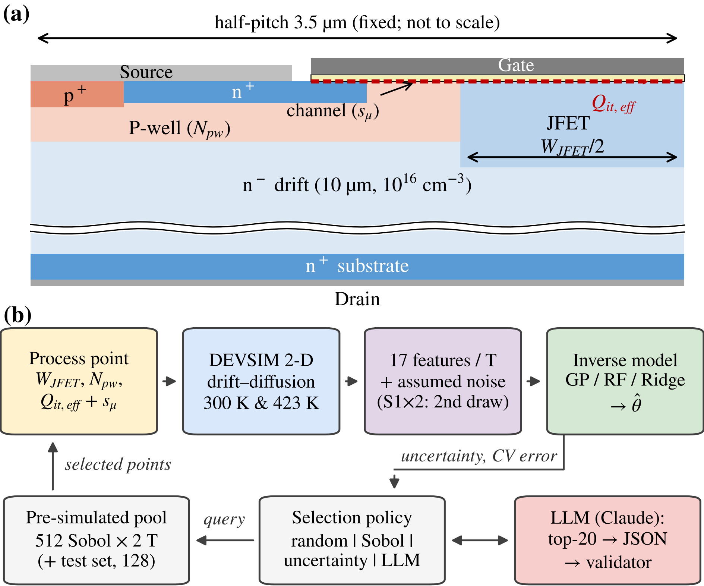
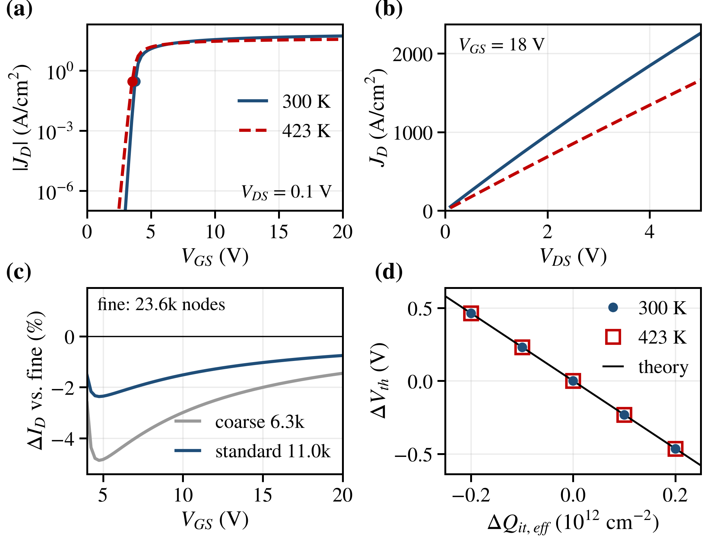
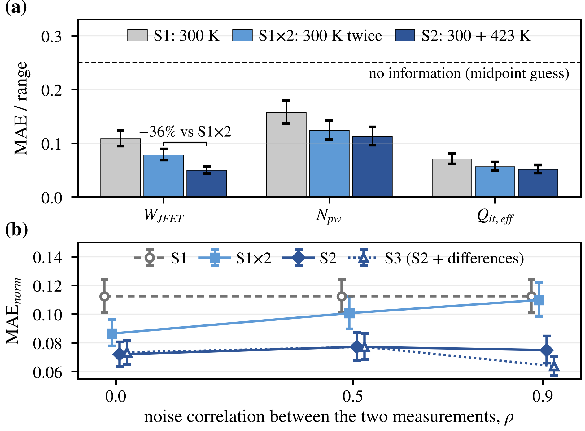
</p>

```bash
python scripts/make_paper_figures.py      # 그림 1–3, 표 1–3, 모델 상수표 (약 5초)
python scripts/check_paper_numbers.py     # 논문 수치 123개 대조 → paper/numbers.csv (약 2초)
```

| 논문 | 내용 | 출력 | 읽는 결과 파일 |
|---|---|---|---|
| 그림 1 | (a) half-cell 단면, (b) 역추정·표본 선택 흐름 | [`paper/figures/fig1_structure_flow`](paper/figures/fig1_structure_flow.png) `.png`·`.pdf` | [`configs/baseline.yaml`](configs/baseline.yaml) |
| 그림 2 | (a) 전달·(b) 출력 특성(300·423 K), (c) 고밀도 메시 대비 전류 오차, (d) Q<sub>it,eff</sub>에 따른 V<sub>th</sub> 이동 | [`paper/figures/fig2_validation`](paper/figures/fig2_validation.png) | [`results/stage_a/runs/`](results/stage_a/runs/), [`results/validation/gate3/`](results/validation/gate3/) |
| 그림 3 (심사본 그림 2) | 시험 128점의 GP 역추정 오차: (a) 파라미터별, (b) 측정 간 잡음 상관 ρ별 | [`paper/figures/fig3_rq1`](paper/figures/fig3_rq1.png) | [`results/summary/repeat_control_points.csv`](results/summary/repeat_control_points.csv), [`repeat_control.json`](results/summary/repeat_control.json) |
| 표 1 | 기준값·범위와 +20 % 변화 시 특징 민감도(g<sub>m,max</sub>·R<sub>on,sp</sub>·I<sub>D</sub>(2 V) 포함 전체) | [`paper/tables/table1_sensitivity`](paper/tables/table1_sensitivity.md) `.md`·`.csv` | [`results/stage_a/`](results/stage_a/) |
| 표 2 | 423 K 물리 시나리오별 S2 오차(물리 일치·불일치·다중 가정 혼합, 직렬저항) | [`paper/tables/table2_physics`](paper/tables/table2_physics.md) | [`results/summary/posthoc_stats.json`](results/summary/posthoc_stats.json), [`repeat_control.json`](results/summary/repeat_control.json) |
| 표 3 | 표본 선택 정책과 LLM 대조 조건의 최종 오차·선택 행동 | [`paper/tables/table3_policies`](paper/tables/table3_policies.md) | [`results/summary/rq3_ablation.json`](results/summary/rq3_ablation.json), [`posthoc_stats.json`](results/summary/posthoc_stats.json) |
| 모델 상수 | 4H-SiC 물성, 이동도 모델, 불완전 이온화, 수명 상수 | [`paper/tables/model_parameters`](paper/tables/model_parameters.md) | [`src/sicsim/params.py`](src/sicsim/params.py), [`configs/baseline.yaml`](configs/baseline.yaml) |
| 본문 수치 | 구조·모델 설정, 검증, RQ1–RQ3 수치 123개(논문 값, 다시 계산한 값, 근거 파일) | [`paper/numbers.csv`](paper/numbers.csv) | `configs/`, `results/` |

그림에 그린 값은 [`paper/figures/figure_data.json`](paper/figures/figure_data.json)에 있습니다. 그림 3의 오차 막대는 시험 소자 부트스트랩(seed 7, 2,000회) 95 % 구간입니다.

## 분석과 결과 파일

모든 분석은 커밋된 run 결과만 읽습니다(DEVSIM 계산 없음). 절 번호는 프로시딩(5쪽)본 기준입니다.

| 분석 | 스크립트 | 출력 | 논문 |
|---|---|---|---|
| 민감도(변수별 ±10·20 %) | [`stage_a_report.py`](scripts/stage_a_report.py) | `results/stage_a/stage_a_deltas.csv`, `stage_a_summary.json` | 3.1, 표 1 |
| 국소 Cramér–Rao 하한(설계 중심 자코비안) | [`identifiability.py`](scripts/identifiability.py) | `results/stage_a/identifiability_nominal.json` | 4.1 |
| 반복 측정 통제 S1×2, 잡음 상관 ρ, 잡음 실현 4회, 직렬저항, ρ별 Cramér–Rao 하한 비 | [`repeat_control.py`](scripts/repeat_control.py) | `results/summary/repeat_control.{md,json}`, `repeat_control_points.csv` | 4.1, 그림 3, 표 2 |
| 423 K 물리 일치(Oracle)·불일치(Mismatch) | [`robustness.py`](scripts/robustness.py) | `results/summary/robustness.{md,json}` | 3.3, 4.2 |
| 다중 가정 혼합 학습(Mixture, 사후 분석) | [`robustness_mixed.py`](scripts/robustness_mixed.py) | `results/summary/robustness_mixed.{md,json}` | 4.2 |
| 시나리오별 S1×2 대비, 같은 시뮬레이션 예산, 시드 수준 통계(최소 검출 차이·동등성) | [`posthoc_stats.py`](scripts/posthoc_stats.py) | `results/summary/posthoc_stats.{md,json}` | 표 2, 표 3, 4.1, 4.3 |
| Ridge 역추정 | [`ridge_rq1.py`](scripts/ridge_rq1.py) | `results/summary/ridge_rq1.json` | 4.1 |
| 표본 선택 곡선(무작위·Sobol·불확실도, 잡음 3수준) | [`run_al.py`](scripts/run_al.py) | `results/al/<none\|nominal\|high>/` | 4.3 |
| 초기 표본 30·90점 | [`al_ninit.py`](scripts/al_ninit.py) | `results/summary/al_ninit_summary.csv`, `al_ninit_curves_n30_n90.csv` | 4.3 |
| LLM 보조 선택 대조(A0·A·B·C·D) | [`rq3_ablation.py`](scripts/rq3_ablation.py) | `results/summary/rq3_ablation.{md,json}` | 3.4, 4.3, 표 3 |
| RQ1–RQ3 요약표 | [`summarize_results.py`](scripts/summarize_results.py) | `results/summary/rq1.md`, `rq1_equal_budget.md`, `rq2.md`, `rq3.md` | 4.1, 4.3 |
| 설계↔run 대응, 특징 재추출, dV<sub>th</sub>/dQ<sub>it</sub> 기울기 감사 | [`audit_results.py`](scripts/audit_results.py) | `results/pool/audit.json` | 2.2 |

## I–V 특성

아래 그림은 모두 [`scripts/make_readme_figures.py`](scripts/make_readme_figures.py)가 커밋된 결과 파일만 읽어 그립니다(약 10초). 그림마다 읽은 파일과 SHA-256은 [`docs/figures/sources.json`](docs/figures/sources.json)에 있습니다.

### 설계 중심 소자

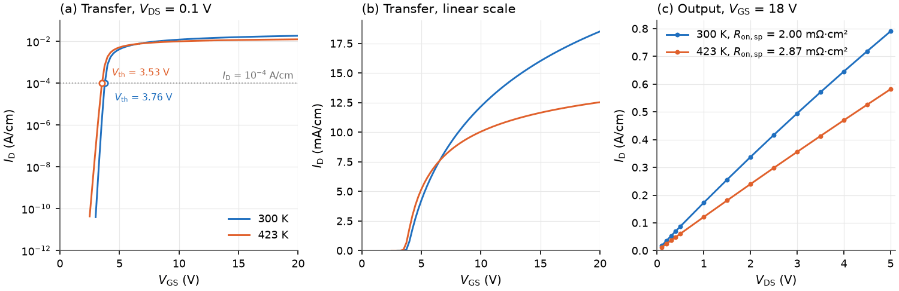

W<sub>JFET</sub>·N<sub>pw</sub>·s<sub>μ</sub> 배율 1, Q<sub>it,eff</sub> = −1×10<sup>12</sup> cm<sup>−2</sup>인 소자입니다. (a) 전달 특성(V<sub>DS</sub> = 0.1 V), (b) 같은 곡선의 선형 축, (c) 출력 특성(V<sub>GS</sub> = 18 V). V<sub>th</sub>는 I<sub>D</sub> = 10<sup>−4</sup> A/cm가 되는 V<sub>GS</sub>이고, 솔버 전류 바닥(약 10<sup>−12</sup> A/cm) 아래 점은 그리지 않았습니다.<br>
원자료: [`results/stage_a/runs/A_base_T300.json`](results/stage_a/runs/A_base_T300.json), [`A_base_T423.json`](results/stage_a/runs/A_base_T423.json)

### 변수 하나씩 ±10·20 %

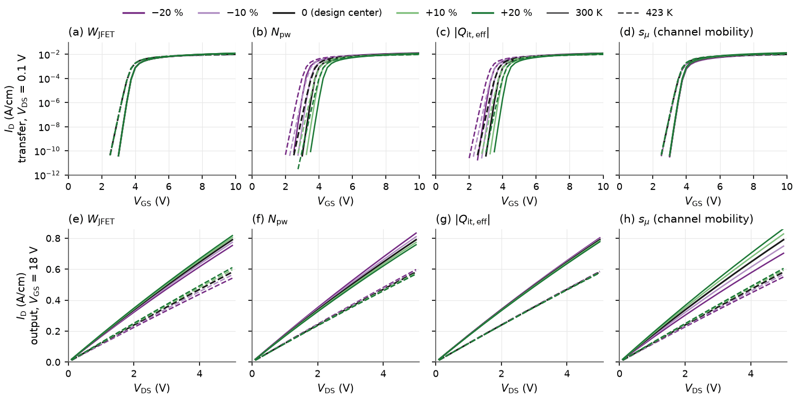

한 변수만 −20, −10, +10, +20 % 바꾸고 나머지는 설계 중심에 둔 32 run과 설계 중심 2 run입니다. Q<sub>it,eff</sub>는 절댓값을 바꿨습니다. 실선 300 K, 파선 423 K.<br>
원자료: [`results/stage_a/runs/`](results/stage_a/runs/)

### 시험 소자 128개

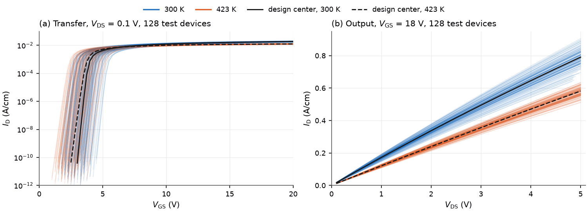

설계 범위에서 무작위로 뽑은 시험 소자 128개([`configs/design_test.csv`](configs/design_test.csv))입니다. 검은 선은 설계 중심 소자입니다.<br>
원자료: [`results/test/runs/`](results/test/runs/)

### 423 K 물리 가정 변형

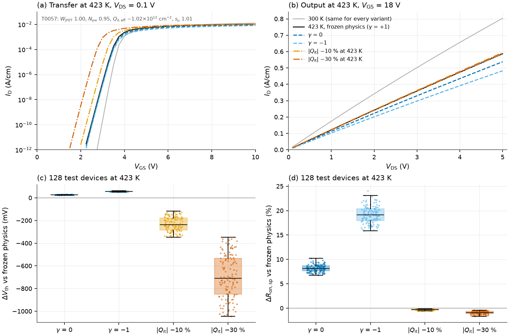

423 K만 다른 물리 가정으로 다시 계산한 결과입니다(가정의 정의: [변수와 조건](#변수와-조건)). (a)·(b) 설계 중심에 가장 가까운 시험 소자 T0057, (c)·(d) 시험 소자 128개의 기준 물리 대비 V<sub>th</sub>·R<sub>on,sp</sub> 변화(상자: 사분위, 수염: 최솟값–최댓값).<br>
원자료: `results/test_{gamma0,gamma_m1,qitT10,qitT30}/`, [`results/test/`](results/test/)

## 추출 특징과 설계 변수

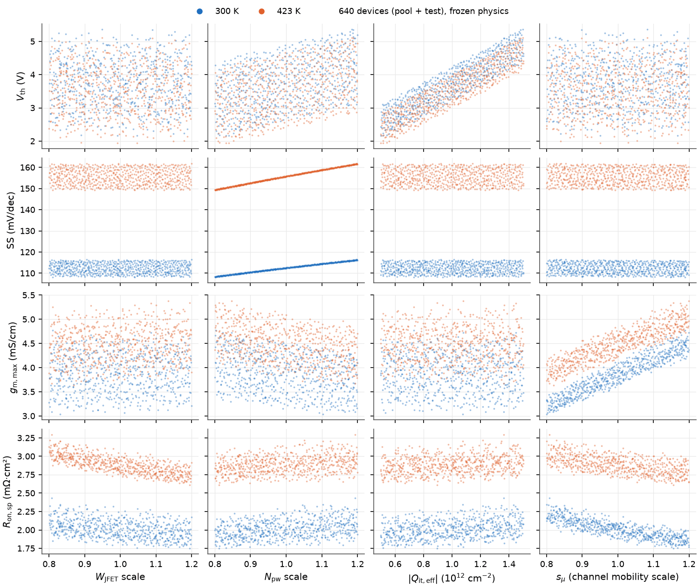

풀 512개와 시험 128개 소자에서 추출한 V<sub>th</sub>, SS, g<sub>m,max</sub>, R<sub>on,sp</sub>를 설계 변수 네 개에 대해 그렸습니다(측정 잡음 없음, 기준 물리).<br>
원자료: [`results/pool/runs.csv`](results/pool/runs.csv), [`results/test/runs.csv`](results/test/runs.csv)

## 역추정 오차

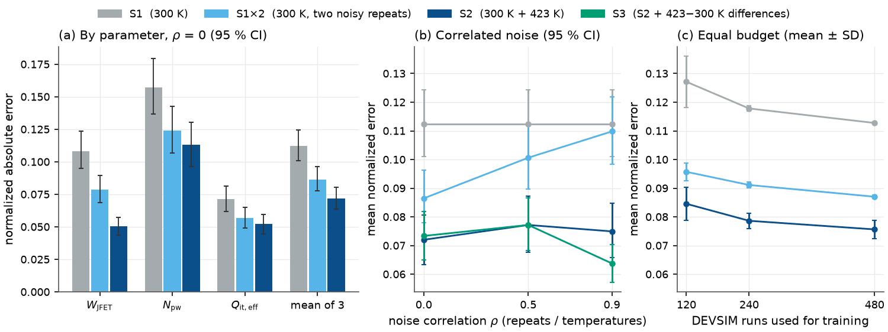

특징에 측정 잡음을 넣고 풀 512개로 학습한 GP 역추정 모델의 시험 소자 128개 정규화 절대오차입니다. (a) 변수별 평균과 95 % 구간(시험 소자 부트스트랩 2,000회), (b) 두 측정 사이 잡음 상관 ρ에 따른 세 변수 평균, (c) 학습에 쓴 DEVSIM run 수를 맞춘 비교(풀 부분집합 5개의 평균 ± SD).<br>
원자료: [`results/summary/repeat_control_points.csv`](results/summary/repeat_control_points.csv), [`posthoc_stats.json`](results/summary/posthoc_stats.json)

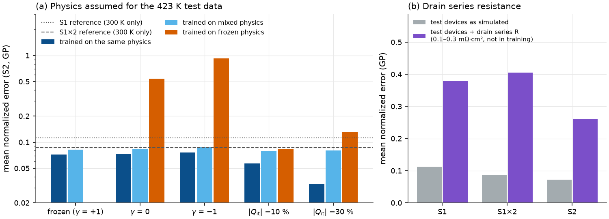

(a) 423 K 시험 데이터를 각 물리 가정으로 계산했을 때 S2 특징 GP 모델의 평균 오차입니다. 같은 가정으로 학습(Oracle), 다섯 가정을 섞어 학습(Mixture), 기준 물리로 학습(Mismatch)한 경우를 비교하며, 수평선은 300 K 특징만 쓴 S1·S1×2입니다. (b) 시험 소자에만 드레인 직렬저항(소자별 0.1–0.3 mΩ·cm<sup>2</sup>)을 넣은 경우입니다.<br>
원자료: [`results/summary/posthoc_stats.json`](results/summary/posthoc_stats.json), [`repeat_control.json`](results/summary/repeat_control.json)

## 표본 선택 곡선

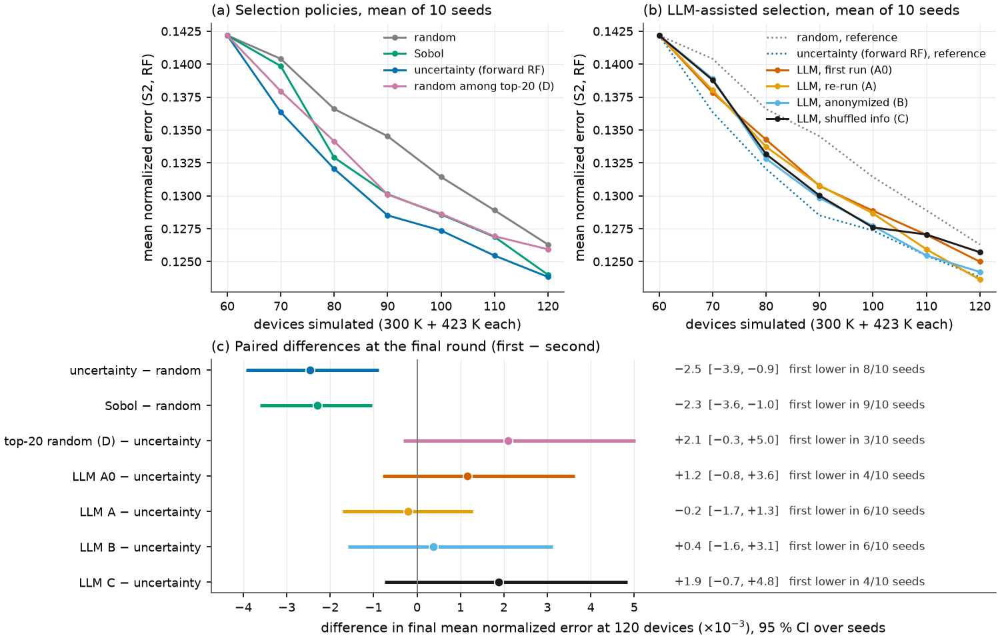

풀 512개에서 초기 60개를 무작위로 고르고 라운드마다 10개씩 6라운드를 더하며, 고른 소자로 학습한 RF 역추정 모델(S2 특징)의 시험 오차를 시드 10개에서 평균했습니다. (c)는 120개 시점 오차의 정책 간 짝지은 차이와 시드 부트스트랩 95 % 구간이고, 오른쪽 열은 앞 정책의 오차가 더 낮았던 시드 수입니다.<br>
원자료: [`results/al_ablation/`](results/al_ablation/), [`results/al_live/nominal/`](results/al_live/nominal/), [`rq3_ablation.json`](results/summary/rq3_ablation.json), [`posthoc_stats.json`](results/summary/posthoc_stats.json)

## 변수와 조건

**시뮬레이션 설정** ([`configs/baseline.yaml`](configs/baseline.yaml), v1.1-frozen. 물성·이동도 상수: [`paper/tables/model_parameters.md`](paper/tables/model_parameters.md))

| 항목 | 값 |
|---|---|
| 구조 | 2차원 half-cell, half-pitch 3.5 µm, 채널 길이 0.5 µm, 게이트 산화막 50 nm, P-well 1×10<sup>17</sup> cm<sup>−3</sup>, JFET 영역 2×10<sup>16</sup> cm<sup>−3</sup>, 드리프트 10 µm·1×10<sup>16</sup> cm<sup>−3</sup> |
| 모델 | Poisson + 전자 연속방정식(Scharfetter–Gummel), 불완전 이온화, 도핑·온도 의존 이동도, SRH, 표면 이동도(λ = 3 nm, 20 cm<sup>2</sup>/V·s × s<sub>μ</sub> × (T/300 K)<sup>γ</sup>), 정적 계면전하 Q<sub>f</sub> + Q<sub>it,eff</sub>(Q<sub>f</sub> = 1×10<sup>12</sup> cm<sup>−2</sup>) |
| 메시·수치 | medium 메시(약 1.1만 노드), 배정밀도, 상대 허용오차 10<sup>−6</sup>, 단일 스레드 |
| 바이어스 | 전달: V<sub>DS</sub> = 0.1 V, V<sub>GS</sub> 0–20 V(61점) · 출력: V<sub>GS</sub> = 18 V, V<sub>DS</sub> 0.1–5 V(14점) |
| 특징(온도당 17개) | V<sub>th</sub>(10<sup>−4</sup> A/cm 정전류), SS, g<sub>m,max</sub>, I<sub>on</sub>, R<sub>on,sp</sub>, I<sub>D</sub>(V<sub>DS</sub> = 2 V), 전달곡선 log I<sub>D</sub> 11점(V<sub>GS</sub> = 4, 5, 6, 7, 8, 10, …, 20 V) |

**설계 변수와 423 K 물리 변형** ([`configs/parameter_bounds.yaml`](configs/parameter_bounds.yaml), [`configs/variants/`](configs/variants/))

| 기호 | 코드 이름 | 값 |
|---|---|---|
| W<sub>JFET</sub> 배율 | `wjfet_scale` | 0.8–1.2 (설계 중심 2.4 µm, 셀 피치 고정) |
| N<sub>pw</sub> 배율 | `npwell_scale` | 0.8–1.2 (설계 중심 1×10<sup>17</sup> cm<sup>−3</sup>) |
| Q<sub>it,eff</sub> | `qit_eff_cm2` | −1.5 ~ −0.5 ×10<sup>12</sup> cm<sup>−2</sup> (300 K 값) |
| s<sub>μ</sub> | `mu_channel_scale` | 0.8–1.2, 채널 이동도 배율(교란 변수, 역추정 대상 아님) |
| γ | `mu_surf_gamma` | 표면 이동도 ∝ (T/300 K)<sup>γ</sup>. 기준 +1, 변형 0(`gamma0`)과 −1(`gamma_m1`) |
| r | `qit_T_reduction_423` | Q<sub>it,eff</sub>(T) = Q<sub>it,eff</sub>(300)·[1 − r(T − 300)/123]. 기준 0, 변형 0.1(`qitT10`)과 0.3(`qitT30`) |

설계점은 [`configs/design_pool.csv`](configs/design_pool.csv)(Sobol 512, seed 2026), [`design_test.csv`](configs/design_test.csv)(무작위 128, seed 12345)이고, 물리 변형은 423 K만 계산했습니다.

**특징 집합과 오차** (측정 잡음: [`configs/noise_model.yaml`](configs/noise_model.yaml), noise-v1.1)

| 이름 | 내용 |
|---|---|
| S1 | 300 K 특징 17개 |
| S1×2 | S1에 독립 잡음을 두 번 넣어 평균한 17개(설계점당 DEVSIM 1 run) |
| S1×2cat | 두 번 측정한 S1을 이어 붙인 34개 |
| S2 | 300 K + 423 K 특징 34개(설계점당 2 run) |
| S3 | S2 + 두 온도의 차 17개 |
| 잡음 | V<sub>th</sub> 10 mV, SS·g<sub>m,max</sub>·전달곡선 2 %, 전류·저항 1 %(기본), 2배 잡음은 모든 σ × 2. ρ는 두 측정 사이 잡음 상관 |
| MAE<sub>norm</sub> | 파라미터별 \|추정 − 참값\| / 변수 범위의 평균(범위 중앙값으로 추정하면 0.25) |
| 역추정 모델 | GP(상수×RBF+백색잡음), RF(트리 300개), Ridge(교차검증 α) — [`src/sicsim/analysis.py`](src/sicsim/analysis.py) |

**표본 선택 정책** ([`src/sicsim/alsim.py`](src/sicsim/alsim.py), [`ablation.py`](src/sicsim/ablation.py), [`llm.py`](src/sicsim/llm.py))

| 이름 | 고르는 방법 |
|---|---|
| 무작위, Sobol | 학습 모델 없이 무작위 또는 Sobol 순서 |
| 불확실도 | 순방향 RF 트리 간 표준편차 u 상위 30개에서 u × (학습점 거리 d)가 가장 큰 점을 10번 차례로 선택 |
| D | u 상위 20개 중 무작위 10개 |
| A0, A, B, C | u 상위 20개의 설계값·u·d와 교차검증 변수별 오차를 LLM(`claude-sonnet-5-5`)에 주고 10개를 JSON으로 받음. A0 1차 실행, A 원래 형식(재실행), B 익명화(변수 이름·물리 설명 제거), C 입력 교란((u, d) 쌍을 섞고 변수별 오차를 순환 이동해 최대 오차 변수를 틀리게 제시). 검증을 통과하지 못한 라운드는 불확실도 선택을 씀 |

## 설치

**GitHub Codespaces.** 저장소 화면에서 **Code → Codespaces → Create codespace on main**(4-core)을 누릅니다. `postCreate`가 의존성(MKL 포함)과 이 패키지를 설치하고 Gate 0을 확인한 뒤, 그 Codespace의 패키지 목록을 `environment.local.txt`(git 제외)에 남깁니다.

**로컬 Linux.**

```bash
git clone https://github.com/mseokq23/sic-mosfet-devsim.git
cd sic-mosfet-devsim
python3.12 -m venv .venv && source .venv/bin/activate
pip install -r requirements.txt && pip install -e .
export MKL_NUM_THREADS=1 OMP_NUM_THREADS=1      # 모든 결과는 단일 스레드로 계산
pytest -q                                       # 56개, 약 30초 (DEVSIM 시뮬레이션 없음)
python scripts/gate0_check.py                   # official diode_1d x2: PASS
```

DEVSIM은 MKL이 없으면 import에 실패합니다. 결과를 만든 패키지 버전은 [`environment.txt`](environment.txt)에 있습니다.

## 실행

### L1 · 분석·요약표·그림을 원자료에서 다시 계산

```bash
bash scripts/reproduce_l1.sh              # 1코어 약 9분
bash scripts/reproduce_l1.sh --with-al    # 표본 선택 곡선(run_al 3회, al_ninit)까지, 약 35분
```

현재 커밋의 임시 worktree에서 아래 명령을 차례로 실행하고, 다시 만든 파일을 커밋된 파일과 숫자로 비교한 표를 출력합니다([`compare_outputs.py`](scripts/compare_outputs.py)). 작업 폴더는 바뀌지 않습니다.

| 순서 | 명령 | 출력 |
|---|---|---|
| 1 | `python scripts/audit_results.py results/pool configs/design_pool.csv results/test configs/design_test.csv` | `results/pool/audit.json` |
| 2 | `python scripts/stage_a_report.py results/stage_a` | `results/stage_a/stage_a_deltas.csv`, `stage_a_summary.json` |
| 3 | `python scripts/identifiability.py results/stage_a` | `results/stage_a/identifiability_nominal.json` |
| 4 | `python scripts/ridge_rq1.py` | `results/summary/ridge_rq1.json` |
| 5 | `python scripts/repeat_control.py` | `results/summary/repeat_control.{md,json}`, `repeat_control_points.csv` |
| 6 | `python scripts/robustness.py` | `results/summary/robustness.{md,json}` |
| 7 | `python scripts/robustness_mixed.py` | `results/summary/robustness_mixed.{md,json}` |
| 8 | `python scripts/posthoc_stats.py` | `results/summary/posthoc_stats.{md,json}` |
| 9 | `python scripts/rq3_ablation.py` | `results/summary/rq3_ablation.{md,json}` |
| 10 | `python scripts/run_al.py --pool results/pool --test results/test --seeds 10 --noise <none\|nominal\|high>` (`--with-al`) | `results/al/<noise>/` |
| 11 | `python scripts/al_ninit.py --n-init 30 90 --seeds 10` (`--with-al`) | `results/summary/al_ninit_*.csv` |
| 12 | `python scripts/summarize_results.py` | `results/summary/rq1.md`, `rq1_equal_budget.md`, `rq2.md`, `rq3.md` |
| 13 | `python scripts/make_paper_figures.py` | `paper/figures/`, `paper/tables/` |
| 14 | `python scripts/make_readme_figures.py` | `docs/figures/` |
| 15 | `python scripts/check_paper_numbers.py` | `paper/numbers.csv` |

- 분석 스크립트를 작업 폴더에서 직접 실행하면 `results/`·`paper/`·`docs/figures/`의 파일을 덮어씁니다. 그때는 `python scripts/compare_outputs.py`로 차이를 보고 `git checkout -- results paper docs/figures`로 되돌립니다.
- 10은 `results/al/`을 다시 만들고 11·12는 그 곡선을 읽습니다. 9는 커밋된 `results/al/nominal/`과 `results/al_ablation/`을 읽습니다.
- `results/al/`의 `llm` 행은 API 없이 규칙으로 고르는 대역(dry-run)이고, 실제 LLM 선택은 `results/al_live/`(A0)와 `results/al_ablation/`(A·B·C)에 있습니다.

### L2 · 소자 검증과 저장된 run 재계산

| 검증 | 비교 | 결과 파일 |
|---|---|---|
| Gate 0 | DEVSIM 공식 1D diode 예제를 두 번 실행해 출력 동일 여부(CI에서 push마다) | [`gate0_check.py`](scripts/gate0_check.py) |
| Gate 1 | 1D 4H-SiC PN 다이오드의 내장전위·공핍폭을 해석해와 비교(300/423 K) | [`gate1_pn_diode.json`](results/validation/gate1_pn_diode.json) |
| Gate 2 | 1D MOS 커패시터의 평탄대 전압을 해석해와 비교 | [`gate2_moscap.json`](results/validation/gate2_moscap.json) |
| Gate 3 | 2D half-cell의 메시(coarse·medium·fine)·정밀도·반복 실행 비교 | [`gate3_summary.json`](results/validation/gate3_summary.json) |

```bash
python scripts/gate1_pn_diode.py         # 11 s
python scripts/gate2_moscap.py           # 9 s
python scripts/gate3_mosfet.py && python scripts/gate3_report.py
python scripts/rerun_check.py            # 시험 소자 T0000을 300·423 K에서 다시 계산해 저장값과 비교(2코어 약 1분)
python scripts/rerun_check.py --set results/test_gamma0 --config configs/variants/gamma0.yaml --temps 423
```

- `rerun_check.py`는 임시 폴더에서 계산하므로 `results/`를 바꾸지 않습니다. 물리·솔버·메시 해시가 다르거나 특징 차이가 10<sup>−9</sup>을 넘으면 종료 코드 1을 돌려줍니다.
- `gate3_mosfet.py`는 이미 있는 사례를 건너뜁니다. 다시 계산하려면 `results/validation/gate3/<사례>.json`을 옮긴 뒤 사례 이름을 인자로 줍니다(예: `ms1.5_dp_300`). Gate 1–3 기록은 설정 동결 전 사전 시험 단계(커밋 `0e4f306`)에 계산했습니다. Gate 3 기록(`baseline-v0.2-pretest`)의 V<sub>th</sub>는 그 설정의 격자 보간 값이고, 300 K medium 메시 곡선은 동결 설정의 설계 중심 run([`A_base_T300.json`](results/stage_a/runs/A_base_T300.json))과 같습니다.

### L3 · 전체 DOE 계산

```bash
python -m sicsim.runner configs/design_pool.csv --out results/pool --jobs 4 --budget-s 20000
python -m sicsim.runner configs/design_test.csv --out results/test --jobs 4
python -m sicsim.runner configs/design_test.csv --out results/test_gamma0 --jobs 4 --temps 423 --config configs/variants/gamma0.yaml
python -m sicsim.runner configs/design_stage_a.csv --out results/stage_a --jobs 4
```

- 러너는 run마다 JSON을 바로 저장하므로 같은 명령으로 중단한 곳부터 이어서 계산합니다. `--shard i/N`은 N개 중 i번째 몫만 계산합니다.
- GitHub Actions의 `doe-batch`(기준 물리 DOE)와 `robustness-batch`(423 K 변형 4가지) 워크플로가 shard 계산, 병합, 커밋을 수행합니다(**Actions → 워크플로 선택 → Run workflow**). 전체 계산량은 약 50 코어·시간입니다.

### LLM 선택 실행

```bash
python scripts/llm_check.py                     # 호출 1회로 키·모델·구조화 출력 확인
bash scripts/run_rq3_ablation.sh llm            # A·B·C 조건 각 60회(약 30–40분) → results/al_ablation/<조건>/
python scripts/run_al.py --pool results/pool --test results/test --seeds 10 --noise nominal \
  --policies llm --replay-log results/al_live/nominal/llm_calls.jsonl --out /tmp/replay_A0   # API 없이 A0 응답 재생
```

- API 키는 `ANTHROPIC_API_KEY` 또는 Codespaces secret `MSEOKQ_CLAUDE`에서 읽습니다([`.env.example`](.env.example)). 키가 없거나 재시도 후에도 호출이 실패하면 멈춥니다.
- 실제 호출은 비결정적이므로 새로 실행하면 커밋된 로그와 다른 선택이 나옵니다. 이미 끝난 조건 폴더는 다시 실행하지 않으므로, 새로 돌리려면 다른 출력 폴더를 주거나 그 폴더를 지웁니다.
- 표본 선택 곡선은 CPU 종류에 따라 라운드 1부터 조금씩 달라지므로, 비교할 조건(`bash scripts/run_rq3_ablation.sh numeric`·`llm`)은 한 세션에서 실행합니다. A0 재생도 커밋된 곡선을 만든 CPU 종류(AMD EPYC 7763)에서만 같은 곡선이 나옵니다.

## 다시 계산한 값의 일치 수준

REPRO_TABLE

## 디렉터리 구조

```text
sic-mosfet-devsim/
├── README.md · LICENSE · CITATION.cff
├── requirements.txt · requirements-optional.txt · environment.txt · pyproject.toml · pytest.ini · .env.example
├── .devcontainer/                     Codespaces 설정(설치, Gate 0, environment.local.txt 기록)
├── .github/workflows/                 ci.yml(단위 시험 + 논문 그림·수치 대조 + Gate 0), doe-batch.yml, robustness-batch.yml
├── configs/                           동결 설정 baseline.yaml, 변수 범위, 잡음 모델, 바이어스 프로토콜, 설계점 CSV, variants/
├── src/sicsim/
│   ├── params.py · physics.py         4H-SiC 물성, DEVSIM 모델식(이동도, 불완전 이온화, 계면전하)
│   ├── devices.py · solver.py · simulate.py   구조와 메시, 바이어스 스윕, 단일 run
│   ├── extract.py                     V_th, SS, g_m, I_on, R_on,sp, 전달곡선 표본 추출
│   ├── runner.py · worker.py          프로세스 격리, 병렬, 재개, shard
│   ├── design.py · config.py · schema.py · utils.py
│   ├── analysis.py · controls.py · robust.py   특징 집합, 잡음, 역추정 모델, 반복 측정, 직렬저항 변환
│   └── alsim.py · ablation.py · llm.py · summary.py   표본 선택 정책, LLM 호출·검증·로그
├── scripts/                           검증(gate*), 분석, 요약, 그림·표, 재현 점검
├── results/
│   ├── pool/ · test/                  기준 물리: 소자 512·128개 × 2온도 (runs/*.json, runs.csv)
│   ├── pool_<변형>/ · test_<변형>/    423 K 물리 변형 gamma0, gamma_m1, qitT10, qitT30
│   ├── stage_a/                       설계 중심 + 변수별 ±10·20 % (34 run)
│   ├── validation/                    Gate 1–3 (PN 다이오드, MOS 커패시터, 메시·정밀도)
│   ├── al/ · al_live/ · al_ablation/  표본 선택 곡선(al_curves.csv), LLM 호출 로그(llm_calls.jsonl)
│   └── summary/                       분석 요약(md, json, csv)
├── paper/                             논문 그림(figures/), 표(tables/), 수치 대조표(numbers.csv)
├── docs/figures/                      README 그림과 sources.json
└── tests/                             단위·파이프라인 시험, 논문 그림·표·수치 재생성 시험(DEVSIM 시뮬레이션 없음)
```

## 데이터 형식

`results/<set>/runs/<run_id>.json`이 원자료이고 `runs.csv`는 이를 평탄화한 표입니다. run_id는 `<candidate_id>_T<온도>`(예: `C0000_T300`, `T0127_T423`)입니다. 전류는 2차원 half-cell의 단위 깊이당 값(A/cm)이고, 면적 정규화에는 half-cell 폭(`width_cm` = 3.5 µm)을 씁니다.

| 그룹 | 필드 | 내용 |
|---|---|---|
| 식별 | `run_id`, `candidate_id`, `process_group_id`, `temperature_K` | 설계점과 온도 |
| 설계 변수 | `wjfet_scale`, `npwell_scale`, `qit_eff_cm2`, `mu_channel_scale` | 시뮬레이터 입력(Q<sub>it,eff</sub>는 300 K 값) |
| 출처 | `config_version`, `physics_hash`, `solver_hash`, `mesh_hash`, `code_commit`, `created_at`, `env` | 설정·물리·코드 버전 |
| 수치 이력 | `converged`, `retry_count`, `n_solves`, `n_fail`, `n_nodes`, `runtime_s` | 수렴과 계산 비용 |
| 곡선 | `curves.transfer` (V<sub>DS</sub> = 0.1 V, V<sub>GS</sub> 0–20 V 61점), `curves.output` (V<sub>GS</sub> = 18 V, V<sub>DS</sub> 0.1–5 V 14점) | I–V |
| 특징 | `vth_V`, `ss_mV_dec`, `gm_max_S_per_cm`, `ion_A_per_cm`, `ron_mohm_cm2`, `id_vds_req_A_per_cm`, `logid_vg4`–`logid_vg20` | 역추정 입력 |
| 품질 표시 | `refined`, `ss_window_resolved`, `vds_reached_V`, `kcl_floor_A_per_cm` | 추출 조건 |

계면전하 변형(`qitT10`, `qitT30`)의 run에는 423 K에서 적용한 값 `qit_eff_at_T_cm2`가 더 있습니다. 표본 선택 결과 `al_curves.csv`는 정책·시드·라운드별 소자 수와 오차를, `llm_calls.jsonl`은 호출마다 모델 ID, 입력 해시, 보여 준 후보(A·B·C), 응답, 검증 결과, 토큰 수, 지연을 담습니다.

## 실행 환경

- Python 3.12, DEVSIM 2.11.0, MKL 2026.1.0, NumPy 2.5.3, scikit-learn 1.9.1, matplotlib 3.11.2 (전체 목록: [`environment.txt`](environment.txt))
- DOE는 GitHub-hosted Ubuntu runner에서, 표본 선택과 LLM 실행은 GitHub Codespaces 4-core(AMD EPYC 7763)에서 계산했습니다. 모든 run은 `MKL_NUM_THREADS=1`, `OMP_NUM_THREADS=1`입니다.
- run당 계산 시간은 중앙값 46 s(3,840 run, GitHub Actions)입니다.

## 사전 기록

설정 동결과 분석 계획은 해당 실행보다 먼저 커밋했습니다. 문서는 저장소 정리 때 최신 트리에서 뺐고 아래 커밋에 그대로 남아 있습니다.

| 기록 | 커밋 | 파일 |
|---|---|---|
| 사전 시험(γ = 0) 후 설정 동결 v1.0: γ = +1, s<sub>μ</sub>를 교란 변수로 추가 | [`d769518`](https://github.com/mseokq23/sic-mosfet-devsim/tree/d769518) | `docs/PRETEST.md`, `docs/ROADMAP.md` |
| 설정 동결 v1.1: 셀 피치 고정 JFET 폭 변화 | [`90dc2e5`](https://github.com/mseokq23/sic-mosfet-devsim/tree/90dc2e5) | `configs/baseline.yaml` |
| 풀·시험 분석 전 예측과 잡음 규칙(noise-v1.1) | [`f542405`](https://github.com/mseokq23/sic-mosfet-devsim/blob/f542405/docs/PREDICTIONS.md) | `docs/PREDICTIONS.md`, `docs/AUDIT.md` |
| 423 K 물리 변형 실행 전 예측 | [`ae73669`](https://github.com/mseokq23/sic-mosfet-devsim/blob/ae73669/docs/PREDICTIONS_ROBUSTNESS.md) | `docs/PREDICTIONS_ROBUSTNESS.md` |
| 반복 측정 통제·RQ3 대조 실행 전 계획(동등 판정 범위 ±0.0025) | [`cb3534b`](https://github.com/mseokq23/sic-mosfet-devsim/blob/cb3534b/docs/PREDICTIONS_V47.md) | `docs/PREDICTIONS_V47.md` |

## 라이선스

코드는 [MIT License](LICENSE)를 따릅니다. DEVSIM 등 외부 소프트웨어는 각 저작권자의 조건을 따릅니다.

문의: 이민석 · minseok1270@gmail.com · [Issues](https://github.com/mseokq23/sic-mosfet-devsim/issues)
